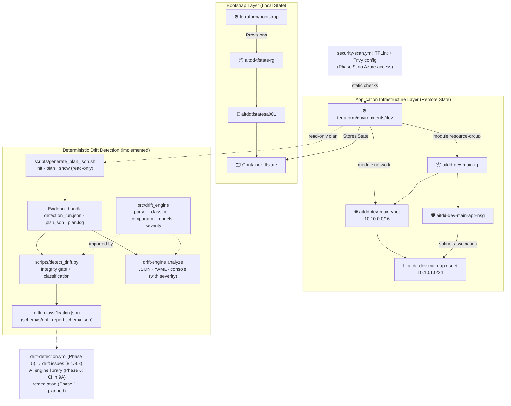

# AI-Powered Terraform Drift Detection & Remediation Platform

> Detect, analyze, and remediate infrastructure drift in Azure using Terraform, Python, LangGraph, and GitHub automation.

> **Maintenance-only (since 2026-10-18).** This is **Level 1**, released as tag `level1-v1.0.0`. It receives only bug fixes, security fixes and documentation corrections, each through a pull request with CI; no new features or phases. The tag `level1-v1.0.0` is never moved; a fix release would get its own new tag. New development happens in Level 2. See [Level 1 and Level 2](#level-1-and-level-2).

Working today:
- the **deterministic** core: Terraform plan evidence, drift classification and a typed
  Python drift engine;
- **scheduled drift detection** in GitHub Actions, with one GitHub Issue per drifted resource;
- an **AI analysis engine** (LangGraph, LLM opt-in) with an `ai-analysis` CLI;
- Activity Log attribution tooling and an automated **drift investigation** (who / when / what);
- **static Terraform security scanning** (TFLint and Trivy) and secret scanning in CI;
- **cost analysis**: an Infracost estimate of each run's Terraform plan, and a separate,
  read-only detection of Azure resources that Terraform doesn't manage, with an Azure Retail
  Prices API list-price estimate;
- a local **dashboard** (loopback API and browser UI) over the real CI artifacts, which can fetch
  new runs from GitHub on demand.

This repository is **Level 1**, released as the stable baseline tag `level1-v1.0.0`. A separate,
more user-friendly Level 2 is developed in another repository (see
[Level 1 and Level 2](#level-1-and-level-2)).

The AI engine has a CLI and a no-LLM CI workflow (Task 9A.1, validated in a real CI run).
Remediation is not part of Level 1 (Phase 11 on hold; transferred to the Level 2 backlog). See
[What works today](#-what-works-today) and [Not in Level 1](#-not-in-level-1-transferred-to-level-2).

---

## 📌 Current Status

**Phases 1–10, 12 and 13 are complete**, and so are the lettered phases 5A, 9A and 9B (Phases 12 and 13
closed 2026-10-20); Level 1 was released as tag `level1-v1.0.0` on
2026-10-18 (see below).

`PROJECT_PLAN.md` reports **"Phases Completed: 12 of 14"**. That figure counts the numbered phases 1–14. The lettered phases are planned separately:
- **Phase 5A** (Dev Infrastructure Expansion) is a completed expansion phase after Phase 5
  (the plan places it before Phase 6). It wasn't skipped; it just isn't counted in "12 of 14".
- **Phase 9A** (AI Analysis Integration) is placed before Phase 10. It is **complete**: Task 9A.1 was validated locally and in a real CI run.
- **Phase 9B** (Drift Investigation: WHO / WHEN / WHAT) is **complete** (2026-10-11). Task 9B.6
  proved it end to end on real Azure: a portal tag change investigated as the sole capable
  operation, a second tag write reported as ambiguous, and a return to in-sync. Phases 6 and 7,
  reopened on 2026-10-04 for the requirement gap that Phase 9B closed, are complete again.

- **Phase 8:** Task 8.2 (automated remediation PRs) is blocked: it was superseded by
  Phase 11 in the 2026-10-03 design review.
- **Phase 9 — DevSecOps Integration** is complete: Task 9.1 (TFLint), Task 9.2 (Trivy
  config security scan) and Task 9.3 (TruffleHog secret scan), all validated in real CI
  runs. Task 9.4 (Super-Linter code-quality enforcement) was **deferred to Phase 12** before
  implementation; Terraform linting stays with TFLint (9.1).
- **Phase 9A — AI Analysis Integration** is complete: Task 9A.1 (the `ai-analysis` CLI and
  the no-LLM `ai-analysis.yml` workflow) was validated in a real CI run.
- **Phase 10 — FinOps / Cost Analysis** is complete (2026-10-11):
  - Task 10.1: Infracost cost estimate in the drift workflow, validated in a real CI run; see
    [Cost Estimate](#-cost-estimate-task-101).
  - Task 10.2: cost delta correlated with drift; see [Cost delta](#cost-delta-task-102).
  - Task 10.3: deterministic cost impact, added to the AI report in v3; see
    [AI Analysis](#-ai-analysis-task-9a1).
  - Task 10.4: detection of Azure resources not managed by Terraform, with a list-price
    estimate (AI report v4); see [Unmanaged Resources](#-unmanaged-resources-task-104).
  - Tasks 10.3 and 10.4 were verified together on real Azure and CI by drift-detection run #44
    and its AI analysis run #27. That run found 5 resources in `aitdd-dev-main-rg` created
    outside Terraform (a VM made in the Azure Portal for the test), with a list-price estimate
    of $44.85/month. The test VM has since been deleted.
- **Phase 12 — Testing & Security Hardening: complete** (closed 2026-10-20). The scope deferred into
  it (e.g. Super-Linter, Task 9.4) was transferred to the Level 2 backlog. Task 12.1A (Terraform plan and
  diagnostic log exposure hardening) is complete: commit `6d1aa86` on `main`, verified by a real
  sentinel check on auth-test run #68 (see [Known limitations](#known-limitations-current-state)).
  Task 12.1 (test tiers, pinned test dependencies and the new `tests.yml` workflow) is complete:
  `tests.yml` run #2 passed (fast tier 48 s; 2,885 tests; 98.85% `src/drift_engine` coverage).
  Task 12.2 (end-to-end scenario matrix with failure injection, 135 cases) is complete; `tests.yml`
  run #4 passed on its commit. Task 12.3 (least-privilege and secret audit) is complete: the
  repository has no hardcoded secrets, the OIDC trust is limited to this repository's `main` branch,
  and the CI identity has only its two documented roles and no client secret (verified 2026-10-16).
  The detailed audit report is kept private. At the Level 1 closeout (2026-10-19) every workflow action
  was pinned by full commit SHA, only the Azure plan job may request an OIDC token, no checkout keeps
  its credentials, and `main` requires a pull request with six passing checks.
- **Phase 13 — Professional Dashboard: built and released in Level 1.** A loopback-only data API
  (`dashboard-api`) and browser UI over the real CI artifacts: drift, investigation (with the
  Azure caller for the `caller_reader` role), AI report, cost and unmanaged resources, and
  **Check GitHub for new runs** with a GitHub token connected from the dashboard (held in server
  memory only). Merged through PRs #10–#14; automated tests pass and the owner tested it on their
  own system. Phase 13 is complete (2026-10-20): Task 13.3's issue-column browser check was done on the real
  fetched data, and the owner validated Task 13.5 against real GitHub (wrong token refused with HTTP 401,
  valid read-only token connected, Check GitHub for new runs completed). The real-Chrome password-prompt
  check was transferred to the Level 2 backlog. PR #17 (2026-10-19) made the GitHub drift issues
  panel follow the run on screen. See [docs/dashboard.md](docs/dashboard.md).
- **On hold: Phase 11 — Human-Approved Remediation** (user decision 2026-10-13). Task 11.1 (Safe
  Remediation Architecture & Controls) is a specification only, paused under review:
  [docs/remediation-safeguards.md](docs/remediation-safeguards.md) (revision 9). No remediation
  workflow, approval environment or write permission exists. Transferred to the Level 2 backlog.
- **Not started: Phase 14** — final documentation, demo and portfolio assets. Transferred to the
  Level 2 backlog.

#### Level 1 and Level 2

- **Level 1** (this repository) is frozen as tag `level1-v1.0.0` (commit `daa95f8`): the stable,
  reproducible baseline. It is **maintenance-only** since 2026-10-18: only bug fixes, security fixes and documentation corrections, each through a pull request with CI; no new features or phases. The tag `level1-v1.0.0` is never moved; a fix release would get its own new tag. New development happens in Level 2.
- **Level 2** is a separate, more user-friendly, local-first application in the private repository
  `HarshAgarwal1102/ai-terraform-drift-detector-v2` (package `aitdd-drift`, command `aitdd`). It
  copied only the drift-engine modules and the public report schema from `level1-v1.0.0`, records
  their provenance, tests that it produces the same reports, and never installs or imports
  Level 1. Its plan and releases live in that repository.
- **Level 1 closeout (2026-10-19)**: security follow-up (pinned actions, least-privilege OIDC,
  no persisted checkout credentials, protected `main`), deferred work transferred to the Level 2
  backlog, and the maintenance watch items (scheduled workflows are disabled by GitHub after 60 days
  without repository activity; the AZU-0012 risk acceptance expires 2027-03-31). Details: the
  **Level 1 closeout** entry in [PROJECT_PLAN.md](PROJECT_PLAN.md).

| Phase | Status |
|---|---|
| 1 — Minimal Terraform foundation | ✅ Complete |
| 2 — Remote state & OIDC authentication (plan-only CI) | ✅ Complete |
| 3 — Deterministic drift detection, validated against a real Azure change | ✅ Complete |
| 4 — Python drift engine | ✅ Complete |
| 5 — Automated drift detection workflow (scheduled + manual) | ✅ Complete |
| 5A — Dev infrastructure expansion (VNet, Subnet, NSG) | ✅ Complete |
| 6 — LangGraph AI analysis engine (library; CLI/CI added in 9A) | ✅ Complete |
| 7 — Azure Activity Log investigation (collector + attribution) | ✅ Complete |
| 8 — GitHub Issue automation (8.1, 8.3; 8.2 superseded by Phase 11) | ✅ Complete |
| 9 — DevSecOps integration | ✅ Complete (9.1, 9.2, 9.3; 9.4 Super-Linter deferred to Phase 12) |
| 9A — AI analysis CLI & no-LLM CI integration | ✅ Complete |
| 9B — Drift investigation (WHO / WHEN / WHAT), proven on real Azure | ✅ Complete |
| 10 — FinOps / cost analysis (Infracost plan estimate, cost delta, AI cost impact, unmanaged resources) | ✅ Complete (10.3 and 10.4 verified on real Azure/CI in run #44) |
| 11 — Human-approved remediation | 🔴 On hold (2026-10-13; Task 11.1 specification paused under review; nothing built; → Level 2 backlog) |
| 12 — Testing & security hardening | ✅ Complete (2026-10-20): 12.1A log-exposure hardening; 12.1 tests.yml run #2 passed; 12.2 tests.yml run #4 passed; 12.3 least-privilege and secret audit; deferred scope → Level 2 backlog |
| 13 — Professional dashboard | ✅ Complete (2026-10-20): 13.1–13.5; released in `level1-v1.0.0` and `level1-v1.0.1` |
| 14 — Final documentation, demo & portfolio | ⬜ Not started (→ Level 2 backlog) |

[PROJECT_PLAN.md](PROJECT_PLAN.md) is the single source of truth for task status, acceptance
criteria and validation evidence.

---

## 🎯 Project Overview

Infrastructure drift is the divergence between Terraform state and the real Azure
resources. Manual changes, failed deployments and policy overrides introduce configuration
gaps that can lead to security vulnerabilities, compliance violations and outages.

### ✅ What works today

- **Read-only drift evidence**: `scripts/generate_plan_json.sh` runs `terraform init`,
  `plan -detailed-exitcode` and `show -json` (never `apply`). It writes an evidence bundle
  (run manifest, plan log, `plan.json`) outside the repository.
- **Deterministic drift classification**: `scripts/detect_drift.py` re-checks the
  evidence (integrity gate) and classifies every managed resource:
  - external drift, external deletion, converged drift, configuration change, added,
    removed, drift plus configuration change, or undetermined;
  - per-attribute detail with recorded / real / desired values;
  - sensitive values redacted.
  The output follows [`schemas/drift_report.schema.json`](schemas/drift_report.schema.json).
- **Validated against real Azure drift**: a scripted external tag change on the `dev`
  resource group was detected exactly (one attribute, `tags.aitdd_drift_probe`) and
  reverted (Tasks 3.6–3.7).
- **Python drift engine** (`src/drift_engine/`): plan parser, classifier, strict Pydantic
  report models, attribute comparator with noise and user-configured assessment, a
  rules-based severity rating, the `drift-engine analyze` command with JSON, YAML and
  console output, and opt-in structured logging. Coverage is gated at 85% (98.85% at the
  last full run). See [Python drift engine](#-python-drift-engine).
- **Plan-only CI with OIDC**: GitHub Actions authenticates to Azure without stored secrets
  and runs `terraform plan`; the identity has no write permissions.
- **Scheduled drift detection** (Phase 5): `drift-detection.yml` runs daily and on demand.
  It publishes the redacted report as an artifact and a `drift_detected` output. A failed
  run is reported as `unknown`, never as "no drift".
- **GitHub drift issues** (Tasks 8.1 and 8.3): one public, structure-only issue per drifted
  resource, closed again only on evidence. Both were validated in real workflow runs. See
  [GitHub Drift Issues](#-github-drift-issues-tasks-81-and-83).
- **AI analysis engine** (Phase 6, `src/ai_engine/`): a LangGraph pipeline over the drift
  report covering security, cost/configuration, root cause/risk and remediation options. It
  produces a JSON + Markdown report via `write_report`.
  - The LLM is opt-in (`AI_LLM_PROVIDER`, default `none`).
  - AI output is validated against the evidence. The deterministic drift result and
    severity are never changed.
  - The `ai-analysis` command and the no-LLM `ai-analysis.yml` workflow (Task 9A.1) run it
    after every valid detection run. See [AI Analysis](#-ai-analysis-task-9a1).
  - Report v3 (Task 10.3) adds the deterministic cost impact from the run's cost estimate:
    exact list-price estimates (never billing), with confirmed drift kept apart from other
    amounts; the LLM never sees or states an amount.
  - Report v4 (Task 10.4) adds a separate section for Azure resources not managed by Terraform
    and their list-price estimate (never drift, never part of the Infracost cost).
- **Activity Log attribution** (Phase 7): `drift-engine activity-logs` collects Azure Activity
  Log evidence (opt-in `[azure]` extra), and `drift-engine attribute` correlates it with
  drifted resources, falling back to "unknown" when logs are missing.
  - The `activity-logs` and `attribute` commands are tested with fake log sources and aren't
    called by any workflow. The same collector (`drift_engine.activity_logs`) runs against the
    real Azure Activity Log in CI through `drift-engine investigate` (Phase 9B).
- **Static security scanning** (Tasks 9.1–9.3): TFLint and Trivy config check `terraform/`,
  and TruffleHog scans the full Git history for secrets, on every push and pull request in
  `security-scan.yml`, without Azure access. See
  [Static Terraform linting](#static-terraform-linting-tflint-task-91) and
  [Terraform security scan](#terraform-security-scan-trivy-config-task-92).
- **Cost estimate** (Task 10.1): after every valid detection run, Infracost v0.10.46 prices the
  same run's plan (list prices, USD) and publishes a sanitised, run-bound
  `infracost-report-<run_id>` artifact. Cost is informational: a cost failure turns the run red
  but never changes the drift result. See [Cost Estimate](#-cost-estimate-task-101).
- **Cost delta** (Task 10.2): `drift_engine.cost` correlates that artifact with the run's
  public drift report and returns per-resource monthly cost deltas, keeping confirmed drift
  separate from configuration, mixed, ambiguous and unmatched amounts. It's a library; the
  AI analysis (Task 10.3) uses it. See [Cost delta](#cost-delta-task-102).
- **Unmanaged resources** (Task 10.4): after every valid detection run, a read-only Azure
  inventory of the Terraform-managed resource groups lists the resources Terraform doesn't
  manage. The separate `unmanaged` job prices them with the public Azure Retail Prices API
  (list prices, USD). This is a separate finding, never drift. Its estimate is never added to
  the Infracost estimate, and the finding never fails the run. Verified on real Azure in run #44.
  See [Unmanaged Resources](#-unmanaged-resources-task-104).

### ⏭️ Not in Level 1 (transferred to Level 2)

These **do not exist in Level 1**. They were transferred to the Level 2 backlog at the Level 1
closeout (2026-10-19); their records stay in [PROJECT_PLAN.md](PROJECT_PLAN.md):

- Human-approved remediation (Phase 11). This includes the remediation-PR scope of the
  superseded Task 8.2: the remediation direction is a human choice, there's no auto-merge
  and no apply triggered by a merge.
- The scope deferred into Phase 12: Super-Linter code-quality enforcement (Task 9.4) and the
  other items listed under Phase 12 in `PROJECT_PLAN.md`.
- Final documentation, demo and portfolio assets (Phase 14).
- The real-Chrome password-prompt check of Task 13.5 (not an acceptance criterion).

### Core principles

- Terraform is the source of truth for **whether** drift exists. AI interprets, explains
  and recommends; it never decides drift.
- Static scanners (TFLint, Trivy) check code quality and security. Their findings are never
  drift results, and they never touch the drift-detection workflow.
- Detection works **without an LLM**. A failed detection is reported as *unknown*, never
  as "no drift".
- "Drift detected" is a valid result, not a pipeline failure. A run with drift succeeds with
  `drift_detected=true`. A detection or process error fails the run with `drift_detected=unknown`.
  Terraform plan exit code 2 means *pending changes*, not necessarily drift; the classification
  decides.
- No autonomous `terraform apply`. Remediation will require explicit human approval.

---

## 🏗️ Architecture



The [drift detection spec](docs/drift-detection-spec.md) defines the detection contract:
commands, exit codes, integrity gate, classification rules and the AI boundary.
[docs/architecture.md](docs/architecture.md) documents the infrastructure and security
design: backend, security controls, OIDC flow, and the CI workflows' access model.

---

## 🛠️ Technology Stack

| Technology | Version | Purpose |
|---|---|---|
| Terraform | `>= 1.6.0` (configuration); 1.14.7 pinned for detection and CI | Infrastructure as Code; plan evidence |
| AzureRM Provider | `~> 5.0` | Azure resource management |
| Azure CLI | 2.x | Local authentication; drift scenario scripts |
| Python | `>= 3.11` (tested on 3.13 and 3.14) | Drift classification and engine |
| Pydantic | `>= 2.11, < 3` | Strict report models |
| PyYAML | `>= 6.0, < 7` | `--format yaml` output |
| pytest, pytest-cov, jsonschema | dev extras | Tests and schema validation |
| LangGraph, langchain-openai | `ai` extra | AI analysis engine (Phase 6); LLM opt-in |
| azure-mgmt-monitor, azure-identity | `azure` extra | Activity Log collector (Phase 7) |
| TFLint + `tflint-ruleset-azurerm` | `0.64.0` + `0.32.0` | Static Terraform linting (Task 9.1) |
| Trivy (`trivy config`) | `0.75.0`, SHA-256-pinned Linux binary in CI | Terraform security scan (Task 9.2) |
| TruffleHog | `3.97.9`, SHA-256-pinned Linux binary in CI | Secret scan of the Git history (Task 9.3) |
| GitHub Actions | Every action pinned by full commit SHA: `actions/checkout` v4.4.0 (v6.1.0 in `tests.yml`), `azure/login` v3.1.0, `hashicorp/setup-terraform` v3.1.2, `actions/setup-python` v5.6.0 (v6.3.0 in `tests.yml`), `actions/upload-artifact` v4.6.2 / `download-artifact` v4.3.0, `terraform-linters/setup-tflint` v6.3.2 | Plan-only CI with OIDC, drift detection, security scans |

`scripts/detect_drift.py` and the engine modules it imports use only the Python standard
library, so they run with plain `python3`. Pydantic and PyYAML are needed only for
`drift_engine.models` and the installed `drift-engine` command.

---

## ☁️ Azure Infrastructure Resources

### Remote State Storage (Phase 2 Bootstrap)

| Resource | Name | Location | Purpose |
|---|---|---|---|
| Resource Group | `aitdd-tfstate-rg` | `Central India` | Dedicated state storage RG |
| Storage Account | `aitddtfstatesa001` | `Central India` | Encrypted, versioned state storage |
| Blob Container | `tfstate` | N/A | Private container for `.tfstate` files |
| State Blob | `dev.tfstate` | N/A | Remote state for the `dev` environment |

The Storage Account and the Blob Container hold the Terraform remote state, so
`terraform/bootstrap/main.tf` sets `lifecycle { prevent_destroy = true }` on both
(Task 9.1). They are intentionally protected from accidental destruction: Terraform refuses
any plan that would destroy them. Destroying them on purpose requires an explicit, reviewed
change that first removes `prevent_destroy`. Adding the setting needed no `terraform apply`:
Terraform evaluates it at plan time and does not store it in state.

### Application Infrastructure (`dev`)

| Resource | Name | Location | Purpose |
|---|---|---|---|
| Resource Group | `aitdd-dev-main-rg` | `Central India` | Parent of all application resources (Phase 1) |
| Virtual Network | `aitdd-dev-main-vnet` | `Central India` | Address space `10.10.0.0/16` (Phase 5A) |
| Subnet | `aitdd-dev-main-app-snet` | `Central India` | `10.10.1.0/24`; default outbound access disabled (Phase 5A) |
| Network Security Group | `aitdd-dev-main-app-nsg` | `Central India` | No custom rules (Azure defaults only); rule set declared empty so out-of-band rules show as drift (Phase 5A) |
| Subnet–NSG association | `aitdd-dev-main-app-snet` ↔ `aitdd-dev-main-app-nsg` | N/A | Applies the NSG to the subnet (Phase 5A) |

All five resources are Terraform-managed drift targets. The footprint stays deliberately
small and cost-free: no compute, public IPs, application storage or Key Vault. Networking is
defined by the reusable `network` module and the `virtual_networks` map in `dev.tfvars`;
each network inherits its resource group's name and location.

---

## 📁 Repository Structure

```
.github/workflows/
├── terraform-auth-test.yml       # OIDC authentication + terraform plan (plan-only)
├── drift-detection.yml           # Daily (02:00 UTC) + manual drift scan: preflight → plan & drift-engine analyze (+ unmanaged inventory, investigation, Infracost) → issues / cost / investigation / unmanaged / report (Phases 5, 8, 9B, 10)
├── security-scan.yml             # Static analysis on push/PR, no Azure access: TFLint (9.1), Trivy config (9.2), TruffleHog (9.3)
├── ai-analysis.yml               # After each drift-detection run on main: no-LLM AI report artifact (9A.1)
└── tests.yml                     # pytest on push/PR, no Azure access: fast tier + full suite with coverage gate (12.1)

ci/
├── ai-constraints.txt            # Exact pins for the AI stack installed in CI (9A.1)
├── azure-constraints.txt         # Exact pins for the investigation's Azure SDK venv (9B.5)
└── dev-constraints.txt           # Exact pins for the test tooling, applied by requirements.txt (12.1)

terraform/
├── bootstrap/                    # Remote-state storage (local state)
├── modules/
│   ├── resource-group/           # for_each-driven resource group module
│   └── network/                  # VNet + for_each subnets/NSGs + subnet–NSG associations (Phase 5A)
└── environments/
    └── dev/                      # Dev environment (remote state, dev.tfvars)

scripts/
├── generate_plan_json.sh         # Read-only plan evidence bundle (Task 3.2)
├── auth_test_plan.sh             # terraform-auth-test.yml dev check; fixed output lines only (Task 12.1A)
├── detect_drift.py               # Drift classification script; thin wrapper over drift_engine
├── github_automation.py          # Drift issue create/update/close (Tasks 8.1, 8.3)
├── infracost_analysis.sh         # Pinned Infracost breakdown of the run's plan.json, fail-closed checks (Task 10.1)
├── inventory_analysis.sh         # Unmanaged resource inventory in CI: pinned venv, drift-engine inventory, public check (Task 10.4)
├── sanitize_infracost.py         # Allowlist sanitiser + run binding for the cost artifact; --check mode (Task 10.1)
├── run_mutation_checks.py        # AI-engine safeguard mutation harness (Task 6.7)
├── run_tflint.sh                 # TFLint over terraform/ (local and CI; Task 9.1)
├── run_trivy_config.sh           # Trivy config security scan + risk-acceptance gate (local and CI; Task 9.2)
├── run_trufflehog.sh             # TruffleHog secret scan of the full Git history (local and CI; Task 9.3)
├── fetch_dashboard_data.py       # Download CI artifacts + issue snapshot for the dashboard (Tasks 13.3–13.5)
├── run_dashboard.sh              # Dashboard launcher; `Start Dashboard.command` wraps it for Finder (Phase 13)
└── validate.sh                   # terraform fmt -check + validate (no Azure auth)

src/drift_engine/                 # Python drift engine (Phase 4)
├── parser.py                     # plan.json loading, integrity gate, S/R/D extraction (4.2)
├── models.py                     # Strict Pydantic report models (4.3)
├── comparator.py                 # Attribute diff, noise and configuration assessment (4.4)
├── severity.py                   # Rules-based severity rating (4.5)
├── classifier.py                 # Resource classification and report building (moved in 4.6)
├── formatters.py                 # JSON / YAML / console rendering (4.6)
├── cli.py                        # drift-engine command (4.6; error handling 4.7; activity-logs 7.1; attribute 7.2)
├── logs.py                       # Structured logging (4.7)
├── activity_logs.py              # Azure Activity Log collector, opt-in [azure] extra (7.1)
├── attribution.py                # Drift ↔ Activity Log correlation and fallback (7.2, 7.3)
├── cost.py                       # Cost delta from the Infracost artifact, correlated with drift (10.2)
├── inventory.py                  # Unmanaged resource inventory: ARM listing + comparison, opt-in [azure] extra (10.4)
├── unmanaged_public.py           # unmanaged_inventory.json contract (10.4)
└── unmanaged_cost.py             # Azure Retail Prices API estimate of unmanaged resources (10.4)

src/ai_engine/                    # LangGraph AI analysis engine (Phase 6; ai-analysis CLI in 9A.1)
├── cli.py                        # ai-analysis command (9A.1)
├── config.py, llm.py, graph.py   # Opt-in LLM configuration and the analysis graph
├── evidence.py, verify.py        # Evidence views and evidence-vs-inference checks (6.7)
└── nodes/                        # parse, security, cost/config, root cause, remediation, report nodes

src/dashboard_api/                # Dashboard data API: loopback FastAPI, roles, caller lookup, GitHub fetch job (Phase 13)
dashboard/                        # Dashboard browser UI (HTML/CSS/JS, node --test component tests) (Phase 13)

schemas/
├── drift_report.schema.json      # Report contract (JSON Schema 2020-12)
└── examples/drift_report.json    # Sample report from a real fixture

tests/
├── fixtures/plan_evidence/       # Sanitized real plan evidence (11 scenarios)
├── fixtures/*_plans/             # Synthetic plans for the AI-engine tests (Phase 6)
├── fixtures/infracost/           # Synthetic priced plan + raw Infracost v0.10.46 samples (Task 10.1)
├── fixtures/retail_prices/       # Real Azure Retail Prices API samples, Central India (Task 10.4)
├── corpora/, mutation/           # Guard/injection corpora and safeguard mutants (Task 6.7)
├── scenarios/                    # Azure CLI tag-drift inject / revert / runner (Task 3.6)
├── integration/                  # End-to-end scenario matrix with failure injection (Task 12.2)
├── tiers.py                      # `integration` / `mutation` markers usable without pytest (Task 12.1)
└── test_*.py                     # Unit tests (see Testing)

docs/
├── drift-detection-spec.md       # Detection contract (Phases 3–4; publication rules of Phases 5, 8, 9A and 10.1)
├── MASTER_PROJECT_GUIDE.md       # Project walkthrough
├── architecture.md               # Infrastructure, security, CI access and application design
├── dashboard.md                  # Dashboard: start, sign-in, GitHub fetch, endpoints (Phase 13)
└── remediation-safeguards.md     # Phase 11 Task 11.1 safeguards specification (on hold, under review)

pyproject.toml / requirements.txt # Python package and dev environment
.tflint.hcl                       # TFLint configuration with exact version pins (Task 9.1)
security/trivy-risk-acceptance.json # The single accepted Trivy finding (AZU-0012), expiry 2027-03-31 (Task 9.2)
PROJECT_PLAN.md                   # Roadmap and task status (source of truth)
```

---

## 🔎 Running Drift Detection

Detection is **read-only**: it never runs `terraform apply` and never changes Azure.
It needs Azure access that can read state and run `terraform plan` for `dev` (locally via
`az login`).

```bash
export ARTIFACT_DIR="$(mktemp -d)"   # must be absolute, empty, and outside the repository
./scripts/generate_plan_json.sh
python3 scripts/detect_drift.py "$ARTIFACT_DIR"
```

`detect_drift.py` writes `$ARTIFACT_DIR/drift_classification.json` and prints a summary,
for example `has_drift=true  [external_drift=1]`. The installed `drift-engine analyze`
command produces the same report (see below).

**Exit codes** describe the process, not the drift verdict:

| Script | `0` | `1` | `64` |
|---|---|---|---|
| `generate_plan_json.sh` | run succeeded (plan exit 0 or 2; see manifest) | detection failed | unusable `ARTIFACT_DIR` |
| `detect_drift.py` | evidence valid and classified (drift or not) | evidence failed or rejected: drift status **unknown** | artifact directory missing |

Evidence bundles and reports can contain resource IDs and must stay outside the repository.
`plan.json` and `tfplan` are gitignored.

---

## 🐙 GitHub Drift Issues (Tasks 8.1 and 8.3)

When a scheduled or manual detection run finds drift (`drift_detected` is `"true"`), the
`issues` job of [`drift-detection.yml`](.github/workflows/drift-detection.yml) runs
[`scripts/github_automation.py`](scripts/github_automation.py) on that run's
`drift-report-<run_id>` artifact and creates or updates **one issue per drifted resource**.

- **Public by design, so minimal**: structure only (address, type, classification, drift
  action, severity, changed paths with value *status*). Never attribute values, HCL, AI
  output, Activity Log data or caller identity. Paths are withheld for security-sensitive,
  higher-severity or redacted drift. GUIDs and ARM IDs are masked.
- **Idempotent**: the first body line is a versioned marker (fingerprint of environment and
  address, content hash, run that last changed the content). An issue is updated only when
  the evidence is newer and the content differs; matching requires the `drift-detected`
  label, the `github-actions[bot]` author and the marker.
- **Least privilege**: the job has `contents: read` and `issues: write` only (no Azure, no
  `id-token`); the token reaches only the script step. Re-running only failed jobs never
  publishes (the evidence must come from the same run attempt).
- **Closing (Task 8.3)**: a valid run (`drift_detected` `"true"` or `"false"`, never `unknown`)
  closes an open drift issue when the issue's resource is in the report and no longer drifted,
  and the run is newer than the issue's marker. Closing sends only
  `{"state": "closed", "state_reason": "completed"}`: no body, title, label or comment, so human
  edits are never overwritten. The record is the issue timeline and the job's step summary.
- **Recurrence**: if the resource drifts again, a **new** issue is opened; closed issues are never
  reopened. An issue whose resource is no longer in the report at all (removed or moved resource)
  stays open with a `resource_not_in_report` warning and needs a manual close.
- **Ownership**: the automation owns the generated title and body and may rewrite them when the
  drift changes; discuss in comments. Removing the `drift-detected` label opts an issue out.
- A conflicting, stale or malformed issue marker is skipped (that issue is not written), the rest of
  the run continues, and the job fails so it gets attention.

**One-time setup** (a repository maintainer, before the first drifted run): the script never
creates labels and fails with `label_missing` if this one is absent.

```bash
gh label create drift-detected --color B60205 --description "Opened by the drift detection workflow"
```

**Local preview** (no network, no token; `--publish` is refused outside GitHub Actions):
download a run's `drift-report-<run_id>` artifact into `.artifacts/`, then

```bash
python3 scripts/github_automation.py --report .artifacts/drift-report/drift_report.json --environment dev --drift-detected true --out-dir .artifacts/issue-preview --repository HarshAgarwal1102/ai-terraform-drift-detector
```

The preview directory receives `requests.json` and one Markdown file per issue.

---

## 🤖 AI Analysis (Task 9A.1)

The `ai-analysis` command runs the Phase 6 AI engine over a drift report and writes
`ai_analysis_report.json` and `ai_analysis_report.md`. It's a separate entry point:
`drift-engine` never imports the AI engine, and a core `pip install .` pulls in no LLM stack.

```bash
pip install -e ".[ai]"
ai-analysis --report .artifacts/drift-report/drift_report.json --output-dir .artifacts/ai-analysis
# with the run's investigation and cost estimate (report v3, Task 10.3)
ai-analysis --report .artifacts/drift-report/drift_report.json \
  --investigation .artifacts/drift-investigation/drift_investigation.json \
  --cost .artifacts/infracost-report --output-dir .artifacts/ai-analysis
# with the run's unmanaged resources (report v4, Task 10.4): the unmanaged-resources-<run id> directory
ai-analysis --report .artifacts/drift-report/drift_report.json \
  --unmanaged .artifacts/unmanaged-resources --output-dir .artifacts/ai-analysis
```

The drift report is read-only input. The drift result, severity and `drift_detected` are
never changed; the AI report is a separate document.

| Exit code | Meaning |
|---|---|
| `0` | report written |
| `1` | input rejected (unreadable or invalid report, or a failed detection run whose drift status is unknown); nothing written |
| `2` | usage error, refused environment, invalid AI configuration, or the `ai` extra isn't installed |
| `70` | internal error |
| `73` | the output couldn't be written |

**No LLM in CI.** The LLM is opt-in (`AI_LLM_PROVIDER`, default `none`). Inside GitHub
Actions the command refuses to run unless `AI_LLM_PROVIDER` is **explicitly** `none`. With
`none` the report holds only deterministic content (summary, resources, remediation options);
the AI sections are recorded as skipped and the LLM as not attempted. Enabling a real LLM in
CI is a separate decision that needs approval (secrets, data leaving the runner, cost).

**Cost impact (Task 10.3, report v3).** With `--cost` (the run's `infracost-report` directory),
the report explains the estimated monthly cost impact with fixed, deterministic statements.
Every amount comes from [`drift_engine.cost`](#cost-delta-task-102), whose full `cost_delta`
v1 document is embedded in the report for traceability.
- `cost.status` is `complete`, `not_available` (no `--cost`, e.g. the cost job failed) or
  `rejected` (a fixed code such as `binding_mismatch` or `cost_input_incomplete`). Only
  `complete` carries amounts; the other two publish one status statement and no amount, and the
  report is still written. Cost never changes the drift result, the investigation or the
  recommendation.
- Amounts are Infracost **list-price estimates** for Terraform-managed resources, **not actual
  Azure billing**. Only the confirmed-drift subtotal is drift cost; the Infracost plan total is
  labelled as drift and pending configuration changes combined. A missing price stays
  "not determinable", never zero.
- The opt-in LLM receives only each resource's deterministic `estimate_direction` (increase,
  decrease, no change, not determinable), never an amount. A cost finding that contradicts it is
  rejected and counted (`direction_conflicts_with_estimate`), its text never published, and the
  cost section's free-text summary is withheld when cost is `complete`.
- The independent verifier recomputes the cost delta from the same input and checks every amount,
  attribution, status, statement, limitation and direction before anything is written.
- Report v3 differs from v2 only in these cost fields (`report_version` "3", `versions.cost_delta`,
  `provenance.cost_input_sha256`, the `cost` block, `resources[].cost`, the cost findings'
  estimate fields and `llm.evidence_sent[].estimate_direction`).
- Verified in a real CI run (AI analysis run #27, triggered by drift-detection run #44): the cost
  report was downloaded and the report recorded its cost status, with a status-only `Cost`
  summary row. Every Terraform-managed dev resource is free, so that run covered the unpriced
  path; the priced path is verified with fixtures.

**Unmanaged resources (Task 10.4, report v4).** With `--unmanaged` (the run's
`unmanaged-resources-<run_id>` directory: `unmanaged_inventory.json` and `unmanaged_cost.json`),
the report gets a separate `unmanaged` block and Markdown section "Unmanaged resources (outside
Terraform)": status `complete` (both documents valid and bound to this drift report),
`not_available` (no `--unmanaged`) or `rejected` (`unmanaged_input_unreadable`,
`unmanaged_input_incomplete`, `contract`, `leak`, `binding_mismatch`; the report is still
written). Fixed `unmanaged.*.v1` statements state the inventory outcome, the counts by type, each
resource's estimate or why it has none, and the total (labelled separate from the Infracost
estimate, never drift cost). Nothing in it reaches the LLM, and drift, cost, investigation and
recommendation fields are identical with and without it. The verifier re-validates both documents
and every statement. Report v4 differs from v3 only in this section (`report_version` "4",
`versions.unmanaged_inventory` / `unmanaged_cost`, `provenance.unmanaged_input_sha256`, the
`unmanaged` block and its limitation lines). Report v4 is the current version; it was produced in
a real CI run (AI analysis run #27) with the unmanaged section filled from run #44.

**Workflow.** [`ai-analysis.yml`](.github/workflows/ai-analysis.yml) runs after each
completed "Phase 5 - Drift Detection" run on `main` (`workflow_run`). It's separate, so an AI
failure can never change the detection run's result. It:
- has permissions `contents: read` and `actions: read` only, and uses no secret except
  `github.token`, to download the source run's artifact. No Azure access;
- checks that the source run is on `main` and was triggered by `schedule` or
  `workflow_dispatch`;
- analyses only a **valid** detection result: the `drift-report-<run_id>` artifact must exist
  and hold the **public** drift report with `outcome: succeeded` and a boolean `has_drift` (drift
  and no drift are both analysed). A missing artifact or a valid public report with
  `outcome: failed` writes "detection result unknown: no AI analysis" to the summary and ends
  without an AI artifact. A present report that is invalid or not the public contract fails the
  job (Task 9B.5);
- passes the run's `drift-investigation-<run_id>` artifact, when present, to
  `ai-analysis --investigation`, which validates it and binds it to the public drift report
  (missing means every drifted resource is `not_investigated`);
- passes the run's `infracost-report-<run_id>` artifact, when present, to `ai-analysis --cost`
  (Task 10.3; missing means cost `not_available`, an unusable one `rejected`);
- passes the run's `unmanaged-resources-<run_id>` artifact, when present, to
  `ai-analysis --unmanaged` (Task 10.4; missing means `not_available`, an unusable one `rejected`);
- requires the report's `run.run_id` to be `github-<source run id>-<source run attempt>`;
  a report from another run or attempt fails the job;
- installs the AI stack only through [`ci/ai-constraints.txt`](ci/ai-constraints.txt),
  which pins every resolved package exactly, and fails if anything installed is unpinned;
- writes a step summary with counts only (resources, remediation options, AI sections,
  investigation, cost and unmanaged status, the unmanaged count, LLM status; never an amount) and
  publishes nothing to issues.

**Artifact.** `ai-analysis-report-<source run id>` (the two report files, 30 days). It has the
same public-exposure profile as the public drift report (Task 9B.4A: `ai-analysis` accepts only
the public report, in which ARM/resource IDs, GUIDs and UPN/email-like identities are `withheld`):
it can contain real non-sensitive attribute values (incl. configured IPs/CIDRs and URLs), HCL
value fragments, remediation command templates with resource addresses, and the deterministic
summary. Sensitive values stay redacted, as in the source report. It
never contains Activity Log data or caller identity.

---

## 🔎 Drift Investigation (Phase 9B)

After a valid drift classification, `plan-and-analyze` investigates every drifted resource against
the Azure Activity Log (read-only, Reader). Steps:
1. `Drift Investigation` runs [`scripts/investigation_analysis.sh`](scripts/investigation_analysis.sh).
2. `Upload Drift Investigation` uploads `drift-investigation-<run_id>` (the **public**
   `drift_investigation.json` only).
3. The `investigation` job verifies it and reports the result.

The investigation never changes `drift_detected`, the drift report, issues, cost or the run summary.
- **Anchors**: for a drifted run, [`scripts/fetch_prior_drift_reports.py`](scripts/fetch_prior_drift_reports.py)
  fetches up to 50 earlier public drift reports (last 30 days) as last-in-sync anchors. A listing
  failure fails closed (`anchor_fetch_failed`).
- **Privacy**: the restricted investigation and Activity Log evidence (recorded callers, ARM IDs) stay
  on the runner (0700). The public file carries caller *type*, client application and verdicts, never
  an identity; `drift-engine who` reproduces the recorded identity locally.
- **Status**: `investigation_status` / `investigation_failure` / `investigation_detail` (fixed codes
  and counts only; an authentication failure adds a fixed `auth_<reason>`, e.g. `auth_assertion_expired`).
- **Azure token**: the Azure CLI session from the OIDC login, for the Resource Manager audience Azure CLI
  cached at login, so the investigation still authenticates after its 10-minute settle wait.
  - An incomplete or failed-but-bindable investigation is still uploaded (the AI report then shows
    why).
  - The `investigation` job needs the investigation to be uploaded and to bind to the public drift
    report. It then passes when the investigation succeeded, and also passes with a warning when it
    is `incomplete` (some facts not confirmed by available evidence). It fails when the
    investigation failed, or when a drifted run has no investigation. On a no-drift run the
    investigation is not required, so skipping it does not fail the job. A failed investigation
    turns the run red but never changes `drift_detected` and is never "no drift".
- **Install**: the Azure SDK is installed in a separate venv pinned exactly by
  [`ci/azure-constraints.txt`](ci/azure-constraints.txt).

---

## 💰 Cost Estimate (Task 10.1)

After every **valid** detection run (`drift_detected` is `"true"` or `"false"`), the drift
workflow prices the **same refreshed `plan.json`** that `drift-engine analyze` classified, with
[Infracost](https://www.infracost.io/) **v0.10.46** (the classic CLI), and publishes a sanitised
cost report. Cost is informational: it never creates, changes or invalidates a drift result.

```
plan-and-analyze:  … → Analyze Drift → Upload Drift Report → Infracost Cost Estimate → Upload Infracost Report
cost job:          Require Cost Success → download both reports → sanitize_infracost.py --check → totals-only summary
```

**Cost step** (end of `plan-and-analyze`, in [`drift-detection.yml`](.github/workflows/drift-detection.yml)):
1. Re-executes its own shell without `ACTIONS_ID_TOKEN_REQUEST_URL`/`_TOKEN`. The runner
   injects these OIDC request variables into every `run:` step of a job with `id-token: write`,
   and blanking them in `env:` doesn't work (seen in CI run #20).
2. Logs out of the Azure CLI (`az logout`, `az account clear`).
3. Downloads the pinned `infracost-linux-amd64.tar.gz` (v0.10.46) and verifies it with
   `sha256sum -c` against the committed SHA-256
   `d0d081cd39b07b2ca5c315830bfc4bcdfb0183b04c19cb18835c154482a2c97b` **before** unpacking.
   No Infracost action, image or install script.
4. Runs [`scripts/infracost_analysis.sh`](scripts/infracost_analysis.sh), which runs exactly
   `infracost breakdown --path <plan.json> --format json --out-file <raw> --no-color` and then
   [`scripts/sanitize_infracost.py`](scripts/sanitize_infracost.py).

The step **always exits 0** and records `cost_status` (`succeeded`/`failed`) and a
`cost_failure` reason. The separate **`cost` job** (`contents: read` only; no `id-token`, no
Azure, no secrets) fails unless the cost step succeeded and its artifact uploaded, then
re-verifies the artifact with the sanitiser's `--check` and writes a totals-only summary. So a
cost failure turns the run **red**, while `drift_detected`, the drift report and artifact, the
`issues` job and the `report` verdict stay exactly as they would without the cost step.

| `cost_failure` | Meaning |
|---|---|
| `none` | succeeded |
| `install_failed` | download, checksum, unpacking or placement of the pinned binary failed |
| `missing_api_key` | `INFRACOST_API_KEY` is missing or empty |
| `oidc_token_present` / `azure_session_present` | an OIDC request variable or an Azure CLI session was still present (fail closed) |
| `version_mismatch` | the binary isn't exactly `Infracost v0.10.46` |
| `infracost_failed` / `raw_output_invalid` | Infracost failed, or its raw output is missing or not JSON |
| `unexpected_egress` | `$HOME/.terraform.d` appeared (Terraform Checkpoint ran) |
| `price_not_found` | a cost component has `priceNotFound: true` |
| `sanitize_failed` | the output failed the allowlist, binding or value checks |
| `usage` | missing/invalid input or an unusable directory (exit 64) |

Cost thresholds don't exist: no cost value ever fails anything.

**Secret.** The repository secret **`INFRACOST_API_KEY`** (an Infracost account and
organisation are required) is referenced only in the cost step. It's never passed as an
argument, printed or written. Infracost runs with an allowlisted environment: `PATH`, an
isolated `HOME`, the key and five fixed controls (`INFRACOST_SKIP_UPDATE_CHECK=true`,
`INFRACOST_ENABLE_CLOUD=false`, `INFRACOST_DISABLE_ENVFILE=true`, `INFRACOST_NO_COLOR=true`,
`CHECKPOINT_DISABLE=1`). `infracost upload`, `comment`, `auth`, `configure` and `generate` are
never run.

**Data leaving the runner** (accepted): pricing queries to the Infracost Cloud Pricing API
(cost-relevant attributes only; no plan file, credentials or resource names) and Infracost's
usage telemetry (counts, command, flags, an ephemeral install ID, CI platform), which v0.10.46
cannot switch off. v0.10.46 also runs `terraform -version` at start-up (through its bundled
Terragrunt code) when `terraform` is on `PATH`. `CHECKPOINT_DISABLE=1` stops that Terraform
process from contacting HashiCorp Checkpoint, and a `$HOME/.terraform.d` after the run fails
closed (`unexpected_egress`).

**Drift-cost sign.** Infracost prices the refreshed real infrastructure (`prior_state`) as the
"past" cost and the desired configuration (`planned_values`) as the current cost:

```
diffTotalMonthlyCost = totalMonthlyCost (desired) - pastTotalMonthlyCost (actual)
drift cost           = -diffTotalMonthlyCost
```

Here "actual" means the refreshed current configuration of the Terraform-managed resources,
priced at list prices. It's an estimate, not actual Azure billing. Task 10.2 publishes this
run-level difference as `infracost_plan_delta`, because it combines drift and pending
configuration changes (see [Cost delta](#cost-delta-task-102)).

Example (the synthetic fixture, verified live): an App Service plan scaled up outside Terraform
from `B1` to `P1v3` gives past `119.72`, desired `13.14`, diff `-106.58` USD/month, so the drift
costs **+106.58 USD/month**.

**Artifact.** `infracost-report-<run_id>` (30 days) holds exactly two files:
- `infracost.json`: an **allowlist** projection of the raw output with Infracost's own key
  names: totals, past/diff totals, usage totals, resource-count summary and, per resource, only
  the Terraform address, type, costs and cost components (name, unit, quantities, price,
  `priceNotFound`). All VCS metadata, paths, project names, tags and resource metadata are
  dropped. Every money, price and quantity value is a **decimal string** (for example
  `"119.72"`), copied unchanged and never parsed as a float.
- `cost_run.json`: the binding manifest: `run_id` (`github-<run_id>-<run_attempt>`, equal to the
  drift report's `run.run_id`), environment, `drift_report_sha256` (the same canonical hash as the
  AI report), Infracost version, mode, pricing and the sign rule.

Its exposure profile is narrower than the drift report's: resource addresses and types, public
list prices and quantities, totals and counts. The raw Infracost output stays on the ephemeral
runner, like `plan.json`.

**Current dev cost: $0.** All five dev resource types (resource group, VNet, subnet, NSG,
subnet–NSG association) are free in Infracost, so the dev estimate is `0` with five no-price
resources (verified in CI run #21). Non-zero pricing is shown only with the synthetic fixture.

**Local check** of a downloaded artifact (stdlib only; exit 0 passed, 1 failed, 2 price not
found, 64 usage):

```bash
python3 scripts/sanitize_infracost.py --check "$PWD/.artifacts/infracost-report" --run-id github-<run_id>-<attempt> --drift-report "$PWD/.artifacts/drift-report/drift_report.json"
```

### Cost delta (Task 10.2)

`drift_engine.cost.cost_delta(public_report, infracost, cost_run)` turns one run's
`infracost-report` into a `cost_delta_version` 1 document. It's a library function with no CLI
command of its own, and it reads no file, clock or network. `ai-analysis --cost` (Task 10.3)
uses it and embeds the document in the AI report.

```python
import json
from pathlib import Path
from drift_engine.cost import cost_delta

load = lambda name: json.loads(Path(name).read_text(encoding="utf-8"))
doc = cost_delta(load("drift_report.json"), load("infracost.json"), load("cost_run.json"))
```

- **Fails closed** (`CostDeltaError` with a fixed code) unless the cost files belong to the same
  run's **public** drift report (run id, environment, canonical hash) and come from the pinned
  Infracost source. Amounts must be decimal strings and are computed exactly with `Decimal`.
- **What the amounts are**: Infracost **list-price estimates** for **Terraform-managed resources
  only**, never actual Azure billing. `past_monthly_cost` is the list-price estimate of the
  refreshed current configuration (`prior_state`), and `desired_monthly_cost` the list-price
  estimate of the declared configuration (`planned_values`). Resources created outside Terraform
  aren't seen at all ([spec §6.3](docs/drift-detection-spec.md#63-limitations--stated-not-hidden)),
  and usage-based charges aren't priced. Every document says so in its `limitations` codes
  (`terraform_managed_resources_only`, `estimate_not_billing`, `list_prices_usd_no_usage_file`).
- **Sign**: `monthly_cost_delta` = estimate of the current configuration − estimate of the
  declared configuration. Positive means the current configuration is estimated to cost more
  than what Terraform declares.
- **Attribution**: Infracost lines are matched to report resources by exact address. Each line
  counts in exactly one subtotal: `confirmed_drift`, `configuration`, `mixed`, `ambiguous` or
  `unmatched`. Only `confirmed_drift` is drift cost. Infracost's run total is reported as
  `infracost_plan_delta`, labelled as drift and pending configuration changes combined.
- **No invented numbers**: a missing amount is `null`, and a resource without a cost line gets a
  reason (for example `no_price_resource_type`), never `0`. Subtotals say whether they're
  `complete`. Resource lines that don't add up to Infracost's totals are reported as a
  reconciliation residual (`unreconciled`) rather than rejected.
- **Display**: `+$106.58/month`, rounded to cents for display only; the exact value is kept.

In dev every resource type is free, so a real run gives `null` deltas with
`no_price_resource_type`. The priced path is tested with the synthetic SKU fixture
(`azurerm_service_plan.this`: `+$106.58/month` as confirmed drift).

## 🧭 Unmanaged Resources (Task 10.4)

Terraform only sees what is in its state, so a VM created in the Azure Portal inside a
Terraform-managed resource group is invisible to drift detection
([spec §6.3](docs/drift-detection-spec.md#63-limitations--stated-not-hidden)). Task 10.4 lists
what actually exists in every **Terraform-managed resource group** and estimates the monthly list
price of everything Terraform does not manage. It is a **separate finding**: it never creates,
changes or invalidates `drift_detected`, the drift report, issues, the investigation or the
Infracost cost estimate.

| | Drift (Terraform-managed) | Unmanaged resources (Task 10.4) |
|---|---|---|
| Question | Does a resource Terraform manages differ from its state? | What exists in a Terraform-managed resource group that Terraform doesn't manage at all? |
| Source | `terraform plan` (refreshed) → `drift-engine analyze` | Read-only ARM listing (`drift-engine inventory`), compared with the plan's managed IDs |
| Result | `drift_detected`, drift report, drift issues | Separate finding: a warning, artifact, job summary and AI report section; no issue |
| Price source | Infracost on the Terraform plan (Tasks 10.1–10.3) | Azure Retail Prices API (list prices, USD) |

The two cost estimates are never added together, compared or subtracted. Neither is actual Azure
billing.

```
plan-and-analyze:  … → Upload Drift Report → Unmanaged Resource Inventory (Reader, GET only) → Upload Unmanaged Inventory → …
unmanaged job:     download inventory → drift-engine unmanaged-cost (Retail Prices API) → unmanaged-check → upload → summary → require
ai-analysis.yml:   downloads unmanaged-resources-<run id> → ai-analysis --unmanaged (report v4, separate section)
```

**Detection** (`drift_engine.inventory`, `drift-engine inventory`):
- **Scope**: every resource group whose ARM ID is a Terraform-managed resource's ID in the run's
  `plan.json` (an `azurerm_resource_group`; in dev, `aitdd-dev-main-rg`). Other resource groups
  are never listed.
- **Inventory**: `GET /subscriptions/<sub>/resourceGroups/<rg>/resources` (api-version
  2021-04-01, every page). Then, for pricing and grouping only, one `GET <id>` per virtual
  machine (with `instanceView`), disk, public IP and network interface. No other requests, never
  a write: anything other than a GET to `management.azure.com` under a resource-group path is
  blocked before a token is requested; no redirects; bounded retries, `Retry-After`, pages
  (50), resources (5000), detail reads (500) and time (240 s; the CI script's hard bound is 300 s,
  and its venv, pip install and checks are bounded too).
- **Comparison**: each listed ARM ID is case-folded and compared with every managed ID in the
  plan (prior state, planned values, resource changes and drift; `report_public.build_index`).
  A match is managed. A disk whose `managedBy` is a Terraform-managed VM is
  `attached_to_managed` (it may be that VM's inline OS disk): reported, never called unmanaged,
  never priced. Everything else is `unmanaged`.
- **Children and grouping**: a resource below another (a VM extension) gets a `parent` link; a
  disk → VM, NIC → VM and public IP → NIC get an `attached_to` link (by reference only).
  Duplicate listing entries are counted once (`duplicates_dropped`).
- **Outcome**: `complete` only when every scope was listed completely and every required detail
  was read; `incomplete` (a bound hit or a detail read failed) or `failed` (403, 404, throttling
  after retries, invalid response, no credential) otherwise. **A failed or incomplete inventory
  is never reported as clean.**

**Cost estimate** (`drift_engine.unmanaged_cost`, `drift-engine unmanaged-cost`):
- **Source**: the public, unauthenticated **Azure Retail Prices API**
  (`prices.azure.com/api/retail/prices`, api-version `2023-01-01-preview`), USD,
  `priceType eq 'Consumption'` (pay-as-you-go list prices). Infracost isn't used: it prices a
  Terraform plan, and these resources are not in it. The requests carry only service, product,
  SKU and region filters, never a resource name, ID or credential.
- **One meter per resource, exactly**: a VM is priced by `armSkuName` + region + OS (the
  `… Windows` product unless Azure Hybrid Benefit is set; Spot and Low Priority meters excluded)
  for **compute only**. A managed disk is priced by its billed tier (the smallest tier at least
  as large as `diskSizeGB`: P/E 1–80, Standard HDD from S4) and redundancy. A Standard IPv4 public
  IP by `Standard IPv4 Static Public IP`. Hourly meters × 730 hours, monthly meters × 1, exact
  `Decimal` arithmetic (JSON numbers parsed as `Decimal`).
- **No double counting**: every resource is priced at most once, by its own type rule; a VM's
  disks and public IP are separate resources and never part of the VM's price.
- **Unknown is never $0**: no matching meter (`price_not_found`), several
  (`ambiguous_price`), a missing input, Spot/Low Priority, an unsupported SKU or type (storage
  accounts, Basic or Global IPs, Ultra/Premium v2 or shared disks, …) are `unavailable` with a
  reason and no amount. Only a fixed list of types Azure does not bill by themselves (NICs, NSGs,
  VNets, route tables, ASGs, VM extensions, SSH keys, auto-shutdown schedules) carry an explicit
  `0` (`no_direct_charge`). Linux images with separately billed software (Red Hat, SUSE, SQL
  Server, marketplace plans) are `partial` (compute only).
- **Assumptions and exclusions** are published per resource as fixed codes: running 730 h/month
  (also for a VM observed `deallocated`), pay-as-you-go, compute only; no data transfer, disk
  transactions, snapshots, reservations, savings plans or usage-based charges.
- **Status**: `complete`, `partial`, `failed` (a Retail Prices API request failed) or `not_run`
  (the inventory was not complete). The total is labelled *"not actual Azure billing; separate
  from the Infracost Terraform plan estimate; never drift cost"*. When any resource's estimate is
  unavailable or partial, the summary and AI report show the total as *"At least $X/month —
  incomplete estimate"*, never as a complete cost.

**Publication** (decision 3): the artifact `unmanaged-resources-<run_id>`
(`unmanaged_inventory.json` + `unmanaged_cost.json`, 30 days), the job summary and AI report v4
show the ARM type, resource name, resource group, location, pricing inputs, estimate,
assumptions and status. Never a full ARM resource ID, subscription ID, tag, IP address or any
other property; a name that looks like an identifier (GUID, e-mail or `@`, URL, IP address, ARM
or subscription path) is withheld. A generated suffix such as a portal OS disk's
`<vm>_OsDisk_1_<32 hex>` is part of the name and is published. No GitHub issue is created for unmanaged resources.

**CI result** (decision 2): unmanaged resources found → success with a warning; partial or
unavailable estimates → warning; a failed or incomplete inventory, a Retail Prices API failure
or a failed verification/upload → the `unmanaged` job fails. `drift_detected` never changes.

**Permissions**: none new. The inventory reuses the existing OIDC login of `plan-and-analyze`
and the identity's subscription **Reader** role (`*/read`). The `unmanaged` job has
`contents: read` only (no `id-token`, Azure or secrets); its only egress is the Retail Prices API.

**Real verification (2026-10-11).** A VM was created in the Azure Portal inside
`aitdd-dev-main-rg`, outside Terraform, and `drift-detection.yml` was dispatched manually.
- Run #44 succeeded, with every job green, including `Unmanaged Resources`. Its warning reported
  5 Azure resources not managed by Terraform, and both unmanaged artifacts were uploaded.
- The inventory completed, and the list-price estimate was $44.85/month.
- The triggered AI analysis run #27 produced report v4 with the unmanaged section.
- The test VM was deleted afterwards. The next scheduled inventory will show whether any of the
  VM's associated resources (disk, network interface, public IP, NSG) remain.

The real run covers one manually created VM. The other pricing rules and failure paths are
verified by tests. Details are in `PROJECT_PLAN.md`, Task 10.4.

**Local use** (read-only; needs `pip install -e ".[azure]"` and `az login`):

```bash
# plan.json and the public drift report of the same plan (generate_plan_json.sh + drift-engine analyze --public-output)
drift-engine inventory --plan "$ARTIFACT_DIR/plan.json" --report "$ARTIFACT_DIR/drift_report.public.json" --output .artifacts/unmanaged/unmanaged_inventory.json
drift-engine unmanaged-cost --inventory .artifacts/unmanaged/unmanaged_inventory.json --report "$ARTIFACT_DIR/drift_report.public.json" --output .artifacts/unmanaged/unmanaged_cost.json
drift-engine unmanaged-check --inventory .artifacts/unmanaged/unmanaged_inventory.json --cost .artifacts/unmanaged/unmanaged_cost.json --report "$ARTIFACT_DIR/drift_report.public.json" --summary-markdown /dev/stdout
```

---

## 🐍 Python Drift Engine

`src/drift_engine/` is the Phase 4 package. The parsing, diff and classification code was
**moved out of** `scripts/detect_drift.py` (not rewritten), and the script now imports it.
The script's output is unchanged.

| Module | Task | What it does |
|---|---|---|
| `parser.py` | 4.2 | Loads `plan.json` (50 MiB limit) and re-applies the integrity gate, including checks that each resource entry's identity fields (address, mode, type, name, index, …) have the shapes Terraform writes. It extracts recorded / real / desired views per managed resource. Bad input raises `EvidenceError`, never another exception. |
| `models.py` | 4.3 | Strict, immutable Pydantic models (`DriftReport`, `DriftSummary`, `DriftItem`, `AttributeChange`) that mirror `schemas/drift_report.schema.json`. They round-trip the classifier JSON exactly. |
| `comparator.py` | 4.4 | Deep attribute diff, plus an assessment of each changed path as `configured` (set in the Terraform configuration), `noise` (declarative rules: computed IDs, timeouts, timestamps, read-only metadata), `unconfigured` or `undetermined`. It annotates only: nothing is dropped and only proven noise is excluded from "significant". |
| `classifier.py` | 4.6 | Resource classification (spec §6) and report building, moved from the script so the CLI and the script share one implementation. |
| `formatters.py`, `cli.py` | 4.6 | `drift-engine analyze`: JSON (default), YAML or console output. See below. |
| `logs.py` | 4.7 | Structured logging on the standard `logging` module. Silent by default; each event has a stable name and fields (identifiers, counts, stages, reasons), never attribute values. |
| `activity_logs.py` | 7.1 | `drift-engine activity-logs --plan --manifest [--lookback-days N] [--output]`: collects Azure Activity Log evidence (`activity_log_evidence.json`) for the drifted resources. Needs the opt-in `[azure]` extra and an Azure login; detection itself never imports it. |
| `attribution.py` | 7.2, 7.3 | `drift-engine attribute --report --evidence [--output]`: correlates drifted resources with exact-resource write/delete operations and records the logged caller only where the correlation rules establish it, otherwise "unknown" (`drift_attribution.json`). Not used by any workflow; Phase 8 never publishes caller identity. |
| `cost.py` | 10.2 | `cost_delta(public_report, infracost, cost_run)`: the cost delta of one run's sanitised Infracost artifact, correlated with drift and bound to the public drift report. Library only. See [Cost delta](#cost-delta-task-102). |
| `inventory.py`, `unmanaged_public.py`, `unmanaged_cost.py` | 10.4 | `drift-engine inventory` / `unmanaged-cost` / `unmanaged-check`: read-only inventory of the Terraform-managed resource groups, case-insensitive comparison with the plan's managed IDs, and the Azure Retail Prices API list-price estimate of the unmanaged resources. Not drift. See [Unmanaged Resources](#-unmanaged-resources-task-104). |
| `severity.py` | 4.5 | Deterministic, rules-based `CRITICAL` / `HIGH` / `MEDIUM` / `LOW` / `INFO` per change and per resource. Examples: Key Vault access policies, NSG inbound rules open to any source and public storage access rate `CRITICAL`/`HIGH`; tags and descriptions rate `LOW`; proven noise rates `INFO`; changes no rule covers default to `MEDIUM`. |

Install for development (a virtual environment is recommended):

```bash
python3 -m venv .venv
source .venv/bin/activate
pip install -e ".[dev]"      # drift engine only
# pip install -e ".[dev,ai]" # also the Phase 6 AI engine (same as: pip install -r requirements.txt)
```

### `drift-engine analyze`

```bash
# JSON report to a file (the run manifest enables the full integrity gate)
drift-engine analyze --plan "$ARTIFACT_DIR/plan.json" --manifest "$ARTIFACT_DIR/detection_run.json" --output report.json

# Human-readable view in the terminal
drift-engine analyze --plan "$ARTIFACT_DIR/plan.json" --manifest "$ARTIFACT_DIR/detection_run.json" --format console
```

| Option | Meaning |
|---|---|
| `--plan PATH` | `plan.json` from `terraform show -json` (required) |
| `--manifest PATH` | Run manifest (`detection_run.json`). Without it, the plan exit-code and Terraform-version checks are skipped, `run` holds only nulls, and a warning is printed. |
| `--output PATH` | Write to a file instead of standard output; a one-line summary is printed |
| `--format json\|yaml\|console` | `json` (default) and `yaml` are the report itself; `console` is a readable view |
| `--color auto\|always\|never` | ANSI colors for `console` (`auto`: terminal only, honours `NO_COLOR`) |
| `--log-level debug\|info\|warning\|error` | Emit structured logs at this level and above to standard error. Default: off. |
| `--log-format text\|json` | Log line format (default `text`; `json` is one object per line) |

- **JSON and YAML** are the report defined by
  [`schemas/drift_report.schema.json`](schemas/drift_report.schema.json), checked against the
  Pydantic models before writing. With `--manifest`, the JSON is byte-identical to what
  `scripts/detect_drift.py` writes for the same bundle.
- **Console** is a readable view of the same report, with the deterministic severity and
  the configured/noise assessment per change. Noise is listed, not hidden. A failed run is
  shown as "drift status UNKNOWN", never as "no drift".

| Exit code | Meaning |
|---|---|
| `0` | Evidence valid and classified (drift or not) |
| `1` | Evidence failed or rejected: drift status unknown. The failed report is still written. |
| `2` | Usage error |
| `70` | Engine defect: the report would break the report contract, or an unexpected internal error occurred. Nothing is written and drift status is unknown. The integrity gate rejects malformed input first. |
| `73` | The output file could not be written |
| `130` | Interrupted (Ctrl-C) |
| `141` | Standard output was closed early, e.g. piped into `head` |

`--output` is written atomically (temporary file in the same directory, then rename):
- A failed or interrupted write leaves no partial file and keeps an existing report
  unchanged, including its permissions.
- An existing report keeps its permission bits, so a `0600` report stays `0600`. A new
  report gets `0666` minus the umask. A report you may not write (e.g. `0444`) is refused
  with exit `73`, as before.
- Because it is a rename, the directory must be writable (otherwise exit `73`; there is no
  non-atomic fallback). A **symlink** at the output path is replaced by a regular file and
  never written through, so the link's target is untouched. A **hard-linked** report gets a
  new file, and other names of the old file keep the old content.

**Logging** is off by default, so standard output and the existing standard-error messages
are unchanged. With `--log-level`, events such as `classification_finished`,
`classification_failed`, `manifest_not_given`, `comparison_finished`, `severity_rated` and
`report_written` go to standard error, never into the report. Event fields carry
identifiers, counts, stages and failure reasons, never Terraform attribute values. The one
exception is an unexpected internal error (exit `70`): its exception message is printed to
standard error, and at `--log-level debug` its traceback is logged. Both are diagnostics of
an engine defect and can contain whatever text that exception carried.

```bash
drift-engine analyze --plan plan.json --manifest detection_run.json --log-level info --log-format json
```

### Library use

```python
from drift_engine import comparator, parser, severity
from drift_engine.models import DriftReport

raw = parser.load_json("/path/outside/repo/plan.json", parser.PLAN_STAGE)
parsed = parser.parse_plan(raw)
comparisons = comparator.compare_plan(parsed, comparator.configured_attributes(raw))
for rated in severity.plan_severity(parsed, comparisons):
    print(rated.severity, rated.address, rated.reasons)

with open("/path/outside/repo/drift_classification.json", encoding="utf-8") as fh:
    report = DriftReport.model_validate_json(fh.read())
```

**Severity in the report (`classification_version` 2):** every attribute change carries
`severity` `{level, rules}` and `assessment` `{category, noise_rule}`, every resource a
`severity` `{level, reasons}`, and `summary` adds `highest_severity` and `severity_counts`.
They are computed by the classifier from the raw plan with the rules above, and they are
authoritative: report consumers, including the AI engine, read them and never re-derive
them. All engine rules are deterministic. None of this uses an LLM.

---

## 🧪 Testing & Validation

```bash
# Pinned dev environment: requirements.txt applies ci/ai-, ci/azure- and ci/dev-constraints.txt
python3 -m venv .venv && source .venv/bin/activate
pip install -r requirements.txt

# Full suite with the coverage gate (fails below 85% for src/drift_engine)
pytest --cov=src/drift_engine tests/

# Fast tier: every test without the `integration` or `mutation` marker (about 22 s)
pytest -m "not integration and not mutation" tests/

# End-to-end scenario matrix with failure injection (Task 12.2; about 8 s)
pytest tests/integration/

# Without installing anything: only the standard-library test modules run; the modules that
# need pytest, Pydantic or PyYAML fail to import (25 of them at present)
python3 -m unittest discover -s tests

# Terraform format + validate (no Azure authentication)
./scripts/validate.sh
```

**Test tiers (Task 12.1).** Two markers, registered in `pyproject.toml`, split the suite:
`integration` (the test runs a subprocess, a bash workflow harness, git or a loopback server)
and `mutation` (a mutation, fuzz or leak-scan loop over many variants). Files written for plain
`unittest` take the markers from `tests/tiers.py`, so they still import without pytest. The full
suite always runs every test; the tiers only decide what the fast job runs.

**CI ([`tests.yml`](.github/workflows/tests.yml), Task 12.1).** On every push to `main`, every
pull request and on manual dispatch, two jobs run on `ubuntu-24.04` with Python 3.12:
- `fast`: the fast tier, with its runtime in the step summary (warning above the 60 s target);
- `full`: every test, then the unchanged 85% gate on `src/drift_engine` and a report-only
  coverage figure for `src/ai_engine`.

The workflow has `contents: read` only: no Azure login, secrets or OIDC token. Its actions are
pinned by full commit SHA (`actions/checkout` v6.1.0, `actions/setup-python` v6.3.0), the checkout
keeps no credentials and nothing is cached. It installs through `requirements.txt`, so CI and a
local environment get the same 66 pinned packages. The pinned set installs from wheels on CPython
3.12 (Linux x86_64 and macOS arm64) and 3.13 (macOS arm64). On 3.14 the AI pin `tiktoken==0.11.0`
has no wheel; everything else resolves.

**Scenario matrix ([`tests/integration/test_scenario_matrix.py`](tests/integration/test_scenario_matrix.py),
Task 12.2).** Five drift scenarios built from the committed fixtures (no drift, single-resource,
multi-resource, security and cost drift) run through the real stages in process: `drift-engine analyze`,
`investigate`, `inventory` / `unmanaged-cost`, the Infracost sanitizer, `ai-analysis` and GitHub issue
publication. Each dependency is then broken in turn:
- the LLM API (refused connection, HTTP 500/503/429, timeout, a reply that is not the JSON envelope; real
  OpenAI client against a loopback server);
- the Azure Activity Log (all 13 query failure codes), Resource Manager inventory (all 14 codes) and Retail
  Prices API (all 8 codes);
- Infracost (no result).

Each failure must be reported with a fixed code and no provider text. The drift reports must stay byte for
byte the same, and every stage that does not need the failed dependency must still produce its normal,
verified output. With the LLM down, for example, the AI report's deterministic sections are identical to the
no-LLM report. No test reaches the network: Azure, GitHub and pricing are fakes, and the LLM outages use
loopback only. The matrix is in the `integration` tier, so CI's full job runs it.

State after Task 4.7: **319 tests pass** with `pytest` (Python 3.13 and 3.14), with **99.87%**
line and branch coverage of `src/drift_engine`. With plain `python3` and no installation, the
same 319 run and 90 are skipped (they need Pydantic and PyYAML).

Latest recorded full run (Task 12.1, `tests.yml` run #2 on 2026-10-16, `ubuntu-24.04`, CPython
3.12): **2,885 passed**, 0 failed, 0 skipped, in 224 s; coverage **98.85%** of `src/drift_engine`
(the gate is 85%) and 97.69% of `src/ai_engine` (reported, no gate). The fast tier is 2,545 of
them: 48 s on the runner, about 22 s locally. Phases after Task 4.7 added the test files
below. Their per-task counts are in the
[PROJECT_PLAN.md](PROJECT_PLAN.md) completion notes:
- `test_ai_*.py`, `test_mutation_corpus.py`: Phase 6;
- `test_activity_logs.py`, `test_attribution*.py`: Phase 7;
- `test_github_*.py`: Phase 8;
- `test_tflint_integration.py`, `test_trivy_config.py`: Phase 9;
- `test_infracost.py`, `test_cost.py`, `test_ai_cost_impact.py`: Phase 10;
- `test_auth_test_workflow.py`, `test_generate_plan_json.py`: Task 12.1A;
- `test_tests_workflow.py` (the tests workflow, dev constraints and tiers): Task 12.1;
- `integration/test_scenario_matrix.py` (scenario matrix, 135 cases): Task 12.2.

| Test file | Covers | Tests |
|---|---|---|
| `test_detect_drift.py` | Classification, integrity gate, attribute detail, redaction, CLI exit codes | 63 |
| `test_parser.py` | Parser: real fixtures, missing/null/unknown fields, malformed input and identity fields, 50 MiB limit | 41 |
| `test_classifier.py` | `evaluate()` with and without a manifest, manifest failures, undetermined branches | 15 |
| `test_models.py` | Models: strict types, JSON round trip, agreement with the JSON Schema | 25 |
| `test_comparator.py` | Diff, configured vs noise assessment, Azure-shaped acceptance cases | 38 |
| `test_severity.py` | Severity rules, escalation, floors, edge cases | 47 |
| `test_cli.py` | `drift-engine analyze`: every format, plan-only and manifest modes, failures, exit codes, console view, logging flags, error handling, atomic output and its permission/link behavior | 63 |
| `test_logging.py` | Structured logging: silent default, every event, formatters, no values in logs | 24 |
| `test_package.py` | Package installation smoke test, version fallback | 3 |

**Live drift scenario** (changes Azure, then reverts it; explicit opt-in):

```bash
tests/scenarios/run_rg_tag_drift_scenario.sh           # read-only: preflight + baseline
tests/scenarios/run_rg_tag_drift_scenario.sh --apply   # inject tag drift, detect, revert, re-detect
```

Its approved run on 2026-10-02 passed 18/18 checks (Task 3.6). Additional validation per
task (golden-output comparisons, fuzzing, mutation checks) is recorded in the completion
notes in [PROJECT_PLAN.md](PROJECT_PLAN.md). Since Task 12.1, `tests.yml` runs the Python tests
in CI (above).

### Static Terraform linting (TFLint, Task 9.1)

TFLint checks the Terraform code under `terraform/`. It is **static linting, not drift
detection**: a TFLint finding fails the lint job and never changes a drift result. It needs
no Azure access and no `terraform init`.

```bash
# Plugins are installed outside the repository (e.g. a scratch directory), never in it.
mkdir -p /tmp/tflint-plugins
TFLINT_PLUGIN_DIR=/tmp/tflint-plugins ./scripts/run_tflint.sh
```

`scripts/run_tflint.sh` is the same command CI runs in
[`security-scan.yml`](.github/workflows/security-scan.yml) on every push and pull request to
`main` (permissions `contents: read` only). It:
- installs the pinned plugins;
- checks that the AzureRM ruleset is loaded;
- runs `tflint --recursive` over `terraform/` with the repository's `.tflint.hcl`.

Any warning or error fails it. Findings are fixed in the code, never suppressed.

| Component | Pinned version | Where |
|---|---|---|
| TFLint | `0.64.0` | `.tflint.hcl` (`required_version = "= 0.64.0"`) and `security-scan.yml` (`tflint_version: v0.64.0`) |
| `tflint-ruleset-azurerm` | `0.32.0` | `.tflint.hcl` (signed release; signature verification left at the default) |
| Terraform rules (bundled) | `0.15.0` | ships with TFLint 0.64.0, `recommended` preset |

A local TFLint of another version is rejected by `required_version`. To upgrade, make one
reviewed change that updates `.tflint.hcl`, `security-scan.yml`, `scripts/run_tflint.sh` (the
expected ruleset version), `tests/test_tflint_integration.py` and this table together.

**AzureRM v5 limitation:** ruleset `0.32.0` was generated from the AzureRM **4.65.0** schema.
This repository uses AzureRM `~> 5.0` (locked at `5.7.0`). The upstream AzureRM v5 work only
removes rules for resources that v5 dropped, and this repository uses none of them. Moving to
a ruleset release with explicit AzureRM v5 support is a separate, reviewed version bump.

### Terraform security scan (Trivy config, Task 9.2)

Trivy `config` checks the Terraform code for Azure security misconfigurations. It is a
**static security scan, not drift detection**: a finding fails the scan job and never
changes a drift result. It needs no Azure access and no `terraform init`.

```bash
# Requires Trivy 0.75.0 and jq on PATH. Run from anywhere; the script scans from the repository root.
./scripts/run_trivy_config.sh
```

`scripts/run_trivy_config.sh` is the same command the `trivy-config` job runs in
[`security-scan.yml`](.github/workflows/security-scan.yml) on every push and pull request to
`main` (permissions `contents: read`, no token). It scans two roots:
- `terraform/environments/dev` with `dev.tfvars`, which also evaluates the
  `resource-group` and `network` modules with the real values;
- `terraform/bootstrap`.

Every scan uses `--skip-check-update` with a fresh, empty cache outside the repository, so
Trivy uses the checks embedded in the verified binary. Trivy logs this as
`ERROR … Falling back to embedded checks`; that line is expected and is not a failure.
Telemetry and version checks are off, and only Terraform misconfigurations are scanned
(no secret or vulnerability scanning).

**Failure policy:**
- HIGH and CRITICAL findings fail, except the single accepted risk below.
- MEDIUM and LOW findings are printed as `REPORTED (non-blocking)`.
- Trivy failing to run, a wrong Trivy version, a missing `jq`, or unreadable JSON also fail.
- There is no `.trivyignore`, no `trivy.yaml`, no inline `trivy:ignore` and no Trivy
  suppression flag. The script fails if any of them appears, and clears `TRIVY_*`
  environment variables.

**Accepted risk** ([`security/trivy-risk-acceptance.json`](security/trivy-risk-acceptance.json)):
- **What:** `AZU-0012` (CRITICAL, alias `AVD-AZU-0012`: network rules default action should
  be Deny) on `azurerm_storage_account.tfstate` in `terraform/bootstrap/main.tf`.
- **Why:** the remote-state account is reached from GitHub-hosted runners with dynamic IPs,
  through Entra ID without account keys. A default-Deny network rule would cut off drift
  detection and the auth workflow, and restricting network access is an architecture change
  outside Phase 9.
- **How it's enforced:** the script matches the finding exactly on Trivy's `ID`,
  `CauseMetadata.Resource` and `ArtifactName + "/" + Target`, and prints it as
  `ACCEPTED RISK` on every run. The run fails if the record is missing, malformed, matches
  no finding (stale) or more than one, or is past its expiry.
- **Expiry:** **2027-03-31**. After that date the scan fails until a reviewed
  `PROJECT_PLAN.md` change renews the acceptance or the risk is fixed.

| Component | Pinned | Where |
|---|---|---|
| Trivy | `0.75.0` | `scripts/run_trivy_config.sh` (required version) and `security-scan.yml` |
| Trivy Linux binary SHA-256 | `c6e65abddb348e25f10549df887045629cf28cc72453cd1c63acb717316b3f3f` | `security-scan.yml`, verified before unpacking |

CI downloads the official release archive and checks the committed SHA-256 before using it.
That hash was taken from Trivy's official checksums file after verifying its cosign
signature. The workflow uses no Trivy GitHub Action and no Docker image tag: in March 2026
`aquasecurity/trivy-action` and `setup-trivy` tags were hijacked to steal CI credentials
([GHSA-69fq-xp46-6x23](https://github.com/aquasecurity/trivy/security/advisories/GHSA-69fq-xp46-6x23)).
Locally, use Trivy 0.75.0 verified against the same official checksums file. To upgrade,
make one reviewed change that updates the version and hash in `security-scan.yml`, the
version in the script, `tests/test_trivy_config.py` and this section together.

The known MEDIUM/LOW findings, all on the state storage account, are reported and don't block:
- AZU-0057: logging;
- AZU-0060: customer-managed key;
- AZU-0061: infrastructure encryption, which would force replacing the account;
- AZU-0058: geo-redundant replication.

### Secret scanning (TruffleHog, Task 9.3)

TruffleHog scans the repository's **Git history** for committed credentials and keys. It is a
**secret scan, not drift detection**: a finding fails the scan job and never changes a drift
result. It needs no Azure access, no token and no `terraform init`. It *detects* secrets that
were committed; it doesn't stop a commit (GitHub's own secret scanning is separate).

```bash
# Requires TruffleHog 3.97.9, git and jq on PATH. Scans the full history of the repository.
./scripts/run_trufflehog.sh
```

`scripts/run_trufflehog.sh` is the same command the `trufflehog` job runs in
[`security-scan.yml`](.github/workflows/security-scan.yml) on every push and pull request to
`main`. The job checks out with `fetch-depth: 0`, so every commit is scanned; there are no
permissions beyond `contents: read` and no token. The script runs:

```bash
trufflehog git file://<repository root> --no-update --no-verification --json --fail
```

- **Full history:** every commit reachable from the checkout's refs (`git log --all
  --diff-filter=AM`). A secret that was later deleted is still found in the commit that
  added it.
- **Not covered:**
  - combined diffs of merge commits (the repository has none);
  - GitHub's `refs/pull/*` refs on `main` runs;
  - untracked or ignored files.
- **`--no-update`:** TruffleHog would otherwise update itself at runtime, which defeats the pin.
- **`--no-verification`:** no candidate secret is ever sent to a provider API, and **every**
  result fails the job, verified or not.
- **Exit codes, passed through unchanged:**
  - `183`: secret found;
  - `1` or another non-zero code: TruffleHog failed to run (a scanner error, not a finding);
  - `0`: clean.

  A wrong version, a missing `jq` or unreadable output also fail.
- **No secret values in logs:** TruffleHog's JSON contains the raw secret, so it is written
  to a private temporary file outside the repository and deleted afterwards. Only detector,
  verification status, file, line and commit are printed. Nothing is uploaded.
- **No suppression:**
  - TruffleHog's inline ignore annotations are rejected anywhere in the files or the history;
  - no exclude, include, result-narrowing, range or depth flags.

| Component | Pinned | Where |
|---|---|---|
| TruffleHog | `3.97.9` | `scripts/run_trufflehog.sh` (required version) and `security-scan.yml` |
| TruffleHog Linux binary SHA-256 | `40377e6572495412fb9ba0bc21c9401f73b72f1d2afd11b9931bc4a5ed622866` | `security-scan.yml`, verified before unpacking |

The hash was taken from TruffleHog's official checksums file after its cosign signature was
verified (identity: the `trufflesecurity/trufflehog` release workflow). The workflow uses no
TruffleHog GitHub Action and no Docker image: the action's default runs the mutable
`ghcr.io/trufflesecurity/trufflehog:latest` image. To upgrade, make one reviewed change that
updates the version and hash in `security-scan.yml`, the version in the script,
`tests/test_trufflehog.py` and this section together.

**If a secret is found:** treat a real secret as compromised and **rotate it first**.
Rewriting Git history is a separate decision that needs explicit approval; it never happens
automatically. A false positive is not suppressed; it needs a reviewed `PROJECT_PLAN.md`
decision (an exact, expiring acceptance, as for Trivy's AZU-0012). The 2026-10-04 baseline
over the full history, including everything published on GitHub, found **no results**.

---

## 🚀 Deployment & Operations Guide

### 1. Authenticate with Azure Locally

```bash
az login
az account set --subscription "<your-subscription-id>"
```

### 2. Provision the Remote State Backend (Bootstrap)

Already provisioned for this project. For a new setup, the backend storage must exist
before the environment can use its remote backend:

```bash
cd terraform/bootstrap
terraform init
terraform plan
# Apply bootstrap after reviewing plan (requires user approval):
terraform apply
```

### 3. Initialize and Plan the Dev Environment

```bash
cd terraform/environments/dev
terraform init
terraform validate
terraform plan -var-file="dev.tfvars"
```

The one-time migration from local to remote state (`terraform init -migrate-state`) was
completed in Phase 2. A fresh clone only needs `terraform init`.

---

## 🔐 GitHub Actions OIDC Authentication Setup

This project uses **GitHub OIDC / Azure Federated Identity Credentials**. No long-lived
client secret, certificate, or storage account access key is used anywhere — the app
registration holds zero credentials.

### Azure Setup Steps

1. **Create the Entra App Registration & Service Principal** (this project uses
   `aitdd-github-oidc`):
   ```bash
   az ad app create --display-name "aitdd-github-oidc" --sign-in-audience AzureADMyOrg
   az ad sp create --id "<app-id>"
   ```

2. **Add the Federated Identity Credential** linking the repository's `main` branch to
   Entra ID:
   - **Issuer**: `https://token.actions.githubusercontent.com`
   - **Audience**: `api://AzureADTokenExchange`
   - **Subject identifier**: must match GitHub's `sub` claim **exactly** — Entra does not
     support wildcards, and a mismatch fails the token exchange *silently, with no error*.

   > **Pick the right subject format.** Repositories created **after 2026-07-15** use
   > GitHub's **immutable** subject format, which embeds numeric owner and repository IDs:
   >
   > ```
   > repo:OWNER@OWNER-ID/REPO@REPO-ID:ref:refs/heads/main
   > ```
   >
   > Older repositories use the legacy form `repo:OWNER/REPO:ref:refs/heads/main`.
   > This repository was created after the cutoff and therefore uses the immutable
   > format. Retrieve the two IDs from
   > `https://api.github.com/repos/<owner>/<repo>` (`owner.id` and `id`).

3. **Assign least-privilege Azure RBAC** — exactly these two, and nothing more:
   - `Reader` at **subscription** scope — read-only metadata for `terraform plan`
   - `Storage Blob Data Contributor` scoped to the **`tfstate` container** (not the
     storage account, not the subscription)

   `Contributor` is **not** assigned. CI is plan-only; see
   [Security Principles](#-security-principles).

   > Creating role assignments requires **Owner** or **User Access Administrator**.
   > A `Contributor` account cannot create them.

4. **Add GitHub repository secrets** under *Settings → Secrets and variables → Actions*:
   - `AZURE_CLIENT_ID` — the App Registration's Application (client) ID
   - `AZURE_TENANT_ID`
   - `AZURE_SUBSCRIPTION_ID`

   These are referenced by the workflow as `${{ secrets.* }}`; their values are
   intentionally not recorded in this repository.

5. **Verify** by running the `terraform-auth-test.yml` workflow. A green run proves the
   federated credential, the secrets, and the RBAC scopes are all correct together.

> Only the `main` branch has a federated credential, and pull requests are never given an
> Azure token. On pull requests to `main` the workflow runs only its offline job,
> `Terraform Offline Validation` (`terraform fmt -check`, then `init -backend=false` and
> `validate` for `terraform/bootstrap` and `terraform/environments/dev`; `contents: read`, no
> secret, no state); the authenticated job `Terraform OIDC Auth & Plan Test` is skipped. On
> pushes to `main` and manual runs the offline job runs first, then the authenticated job
> (`id-token: write`: Azure login, context check and the read-only dev plan).

---

## 🔒 Security Principles

| Principle | Implementation |
|---|---|
| Backend Isolation | State storage is separated from app storage. |
| No Committed Secrets | Credentials, tokens, state files and plan artifacts are gitignored; drift evidence is written outside the repository. |
| OIDC Authentication | Workload Identity replaces static Azure client secrets in GitHub Actions. The single federated credential accepts only this repository's `main` branch, and the identity has no client secret or certificate (both re-verified 2026-10-16). |
| State Security | State blob versioning enabled; container set to private. |
| Least Privilege | Exactly two RBAC assignments on the CI identity: `Reader` (subscription) and `Storage Blob Data Contributor` (`tfstate` container). No `Contributor`, `Owner`, or `User Access Administrator`. Re-verified by the Task 12.3 audit (2026-10-16). |
| Plan-Only CI | GitHub Actions has **no autonomous `terraform apply` capability**, enforced by RBAC rather than convention: the identity holds no control-plane write actions (`*/read` only; re-verified 2026-10-16). Its data-plane write is limited to the `tfstate` container. Any future remediation/apply capability requires explicit human approval. |
| No Storage Account Keys | `listkeys` is denied to the CI identity (re-verified 2026-10-16), so state access uses Entra ID on the data plane (`ARM_USE_AZUREAD=true`) instead of account keys. |
| Sensitive Values Redacted | Values Terraform marks sensitive are never emitted in drift reports. |
| Static Security Scanning | TFLint and Trivy config check `terraform/` on every push and PR (`security-scan.yml`, `contents: read`, no Azure, no OIDC). HIGH/CRITICAL Trivy findings fail the job except one documented, expiring risk acceptance (AZU-0012, until 2027-03-31). |
| Secret Scanning | TruffleHog scans the full Git history on every push and PR. Every result fails the job; secret values are never printed or uploaded; candidates are never sent to provider APIs (Task 9.3). |
| State Destroy Protection | `prevent_destroy` on the remote-state storage account and container (Task 9.1). |
| Public Issue Profile | Drift issues carry structure only: no values, HCL, AI output, Activity Log data or caller identity (Task 8.1). |
| Cost Estimate Isolation | Infracost v0.10.46 is SHA-256 verified before use, runs without OIDC request variables or an Azure CLI session, with an allowlisted environment, and fails closed on any of them (or on Checkpoint egress). Its artifact is an allowlisted, run-bound projection; a cost failure never changes the drift result (Task 10.1). |
| Log Exposure Hardening | The hardened steps (the auth-test plan step via `scripts/auth_test_plan.sh`, both `Verify Azure OIDC Authentication` steps, and `drift-detection.yml`'s Generate Plan Evidence) print no Terraform plan output, no `plan.log` content, no raw Terraform/jq/`az` error text and no Azure account values: only fixed lines, exit codes, validated action counts and fixed failure codes. Plan and diagnostic files stay on the runner. Not all Terraform output is sanitized: the `drift-detection.yml` init/validate steps and the auth-test bootstrap and formatting steps still print Terraform's own output (see [Known limitations](#known-limitations-current-state)) (Task 12.1A; verified live on push-triggered auth-test run #68; `drift-detection.yml` is covered by local tests only, no live run inspected). |
| Read-Only Unmanaged Inventory | The inventory uses the existing Reader session for GET requests only, limited to `management.azure.com` resource-group paths (anything else is blocked before a token is requested). Its public output never contains ARM resource IDs, subscription IDs, tags or IP addresses. The pricing job has no Azure access or secrets (Task 10.4). |

---

## 🗺️ Project Roadmap

| Phase | Description | Status |
|---|---|---|
| 1 | Terraform + Azure foundation (minimal baseline) | ✅ Complete |
| 2 | Remote state backend + secure auth (plan-only CI) | ✅ Complete |
| 3 | Deterministic Terraform drift detection | ✅ Complete |
| 4 | Python drift engine | ✅ Complete |
| 5 | Scheduled GitHub Actions drift detection | ✅ Complete |
| 5A | Dev infrastructure expansion (VNet, Subnet, NSG) | ✅ Complete |
| 6 | LangGraph AI analysis | ✅ Complete (library; CLI/CI added in 9A) |
| 7 | Azure Activity Log investigation | ✅ Complete |
| 8 | GitHub Issue/PR automation | ✅ Complete (8.1, 8.3; 8.2 superseded by Phase 11) |
| 9 | DevSecOps scanning | ✅ Complete: 9.1 TFLint, 9.2 Trivy config, 9.3 TruffleHog (9.4 Super-Linter deferred to Phase 12) |
| 9A | AI analysis CLI & no-LLM CI integration | ✅ Complete |
| 9B | Drift investigation (WHO / WHEN / WHAT) | ✅ Complete (proven on real Azure in Task 9B.6) |
| 10 | FinOps / Infracost | ✅ Complete: 10.1 Infracost integration, 10.2 cost delta, 10.3 AI cost impact (report v3), 10.4 unmanaged resources + Azure Retail Prices list-price estimate (report v4); 10.3 and 10.4 verified on real Azure/CI in run #44 |
| 11 | Human-approved remediation | 🔴 On hold (2026-10-13): Task 11.1 safeguards specification paused under review; 11.2–11.3 not started; → Level 2 backlog |
| 12 | Testing and hardening | ✅ Complete (2026-10-20): 12.1A log-exposure hardening (verified on auth-test run #68 and drift run #54); 12.1 (tests.yml run #2 passed); 12.2 (tests.yml run #4 passed); 12.3 (least-privilege and secret audit). Deferred scope → Level 2 backlog |
| 13 | Professional dashboard | ✅ Complete (2026-10-20): 13.1–13.5 (PRs #10–#14, #17); released in `level1-v1.0.0` and `level1-v1.0.1` |
| 14 | Final documentation / demo | ⬜ Not started (→ Level 2 backlog) |

### Known limitations (current state)

- Five resources are managed (resource group, VNet, subnet, NSG, subnet–NSG association), but
  real Azure drift has so far been exercised only on the resource group (tags). The network
  resources are verified in sync after apply; NSG severity rules, like the Key Vault and storage
  rules, are verified on synthetic plans only.
- A subnet created outside Terraform inside the managed VNet is not visible to the plan (the
  VNet's inline `subnet` attribute is provider-computed and left unmanaged).
- Right after an apply that adds a subnet and its NSG association, provider-computed attributes
  are stale in state and the engine reports them as `converged_drift` until a reviewed
  `terraform apply -refresh-only` records them (see Task 5A.1).
- Scheduled detection (`drift-detection.yml`, daily 02:00 UTC) uploads only the contract report
  (sensitive values redacted by the engine) and run manifest as `drift-report-<run_id>` (30 days).
  Raw plan evidence (`tfplan`, `plan.json`, `plan.log`) is kept only on the ephemeral runner and is
  not uploaded or otherwise persisted. The internal report can contain resource identifiers (e.g.
  the subscription ID) when an `id` attribute changes, so it stays on the runner. Only its public
  projection (Task 9B.4A, `drift-engine analyze --public-output`; identifiers withheld) is uploaded
  (Task 9B.5).
- Log exposure (Task 12.1A, fixed in commit `6d1aa86`, 2026-10-13). Runs before that commit
  printed the full `terraform plan` of `terraform-auth-test.yml`, the `plan.log` tail of a failed
  detection and `az account show` (masked IDs) to the public log. Since the change:
  - `terraform-auth-test.yml` runs [`scripts/auth_test_plan.sh`](scripts/auth_test_plan.sh)
    (wrapper off) and prints only `auth-test: terraform_version=…`, `auth-test: init=succeeded
    validate=succeeded` and `auth-test: plan_exit_code=<0|2> add=N change=N destroy=N replace=N
    import=N moved=N forget=N output_changes=N`, or one `::error::auth-test failed:
    failure_code=<code>` line (`preflight_failed`, `version_mismatch`, `init_failed`,
    `validate_failed`, `plan_failed`, `plan_unexpected_exit`, `show_failed`, `plan_json_invalid`,
    `counts_inconsistent`, `internal_error`). A plan whose JSON fails validation (unknown action
    shape, `errored`, incomplete, wrong version) or disagrees with the exit code fails closed and
    never shows counts;
  - both `Verify Azure OIDC Authentication` steps compare the context with the configured values
    and print only a fixed line or `auth_configuration_missing` / `auth_context_unavailable` /
    `auth_context_mismatch`;
  - `Generate Plan Evidence` no longer prints the `plan.log` tail, and `generate_plan_json.sh`
    failure reasons are fixed text (no jq error text, no plan values).
  - Verified: the real sentinel check (E6 item d) passed on push-triggered auth-test run #68 with a
    temporary probe tag (since removed): the log shows only the fixed lines
    (`plan_exit_code=2 … change=1`, all other counts 0) and none of the probe tag, `Refreshing
    state`, `/subscriptions/` or account data. Verified live on 2026-10-20 (scheduled drift-detection run #54): its
    auth check printed only the fixed line; the removed `plan.log` tail could only appear on a failed
    run and stays covered by local tests.
  - Accepted residual: the logs of runs before `6d1aa86` were not reviewed or deleted at the Level 1
    closeout; they stay readable by signed-in GitHub users until GitHub's log retention removes them
    (90 days by default; see [`docs/remediation-safeguards.md`](docs/remediation-safeguards.md) §12.1). Residual: the
    drift-detection `terraform init`/`validate` steps still print Terraform's own output (failure
    text can include backend and resource names, which are public in `backend.tf`/`dev.tfvars`).
    The auth-test `Validate Bootstrap Configuration` (offline, `-backend=false`) and `Check
    Terraform Formatting` steps also still print Terraform's own output for the committed
    configuration.
  - The fix is a recorded prerequisite before any remediation apply can be enabled (Phase 11,
    gate E6).
- Drift issues (Task 8.1) are public: a reduced body still shows the resource type, address and
  severity. Values, paths of security-relevant drift and callers are never published.
- Issues for resources removed from the configuration or moved to a new address are not closed
  automatically (`resource_not_in_report`); close them by hand.
- Terraform reports drift only for resources and attributes it manages. Unmanaged resources
  are invisible to this method ([spec §6.3](docs/drift-detection-spec.md#63-limitations--stated-not-hidden)).
  Task 10.4 lists them separately for the Terraform-managed resource groups only (other resource
  groups, data-plane objects and child resources that ARM's resource list doesn't return are
  not covered).
- Unmanaged-resource estimates (Task 10.4) are Azure Retail Prices API list prices: no discounts,
  reservations, savings plans, usage-based charges or actual billing; a VM is assumed to run 730
  hours a month. Only VMs, managed disks (Standard/Premium SSD, Standard HDD) and Standard IPv4
  public IPs are priced; other billable types are `unavailable`. The comparison needs Terraform's
  `id` to equal the ARM ID; a resource whose provider ID differs would be listed as unmanaged.
  Real Azure verification (run #44, 2026-10-11) covered one VM created in the portal. The other
  pricing rules and the incomplete, failed and API-failure paths are verified with real Retail
  Prices API samples and scripted ARM responses only.
- The report file is named `drift_classification.json`; the plan calls it `drift_report.json`.
  Both refer to the same document.
- The AI workflow (Task 9A.1) runs without an LLM, so its report holds only deterministic
  content (validated in a real CI run on a no-drift result). A real model's analysis quality
  hasn't been verified; tests use fake chat models.
- The drift investigation (Phase 9B) has run against the real Azure Activity Log in CI and was
  accepted end to end in Task 9B.6. That proof covers tag changes on one resource group (a
  sole capable operation, an ambiguous second write and a return to in-sync), not every kind
  of Azure drift. Activity Log events carry no property values, so the link between an
  operation and a changed attribute is always `inferred_not_provable`, and a recorded caller
  is never reported as the confirmed actor. The `latest_capable_operation` and
  confirmed-deletion paths are verified with fixtures only, because no safe real producer
  exists.
- Trivy reports four non-blocking MEDIUM/LOW findings on the state storage account, and
  AZU-0012 (no network rules) is an accepted risk until 2027-03-31. Fixing them needs Azure
  architecture or apply decisions outside Phase 9.
- `tflint-ruleset-azurerm` 0.32.0 was generated from the AzureRM 4.65.0 schema, although
  the repository uses AzureRM 5.x (see the TFLint section).
- Cost estimates (Task 10.1) are public list prices in USD without a usage file: no discounts,
  reservations or actual billing, and prices change over time (each result is tied to its
  `timeGenerated`). The dev environment costs $0, so non-zero CI pricing hasn't been observed;
  the sign rule was verified with a live run on a synthetic plan. A usage-based resource without
  usage data (null quantities) would fail sanitisation (`sanitize_failed`).
- The cost delta (Task 10.2) and the AI cost impact (Task 10.3) have their priced path
  verified only with the synthetic fixture, because every dev resource type is free; a real dev
  run reports the drifted resource group as `no_price_resource_type` with no amount. The AI cost
  impact ran in a real CI run (AI analysis run #27) on that unpriced path. Infracost's
  resource `name` format for module and `for_each` addresses hasn't been seen in real output;
  if it differs from the Terraform address, those amounts are reported as `unmatched`, never
  attributed to drift.
- Infracost's usage telemetry can't be disabled in v0.10.46. The `plan-and-analyze` job keeps
  `id-token: write` (needed for the Azure login), so the runner still holds the OIDC request
  credential for that job; the cost step only removes it from its own process environment.
- TruffleHog 3.97.9 has no Infracost detector, so the secret scan wouldn't catch a leaked
  Infracost key; protection relies on the cost step never printing or writing it (Phase 12
  hardening candidate).

---

## 📄 License

This project is licensed under the [MIT License](LICENSE).
