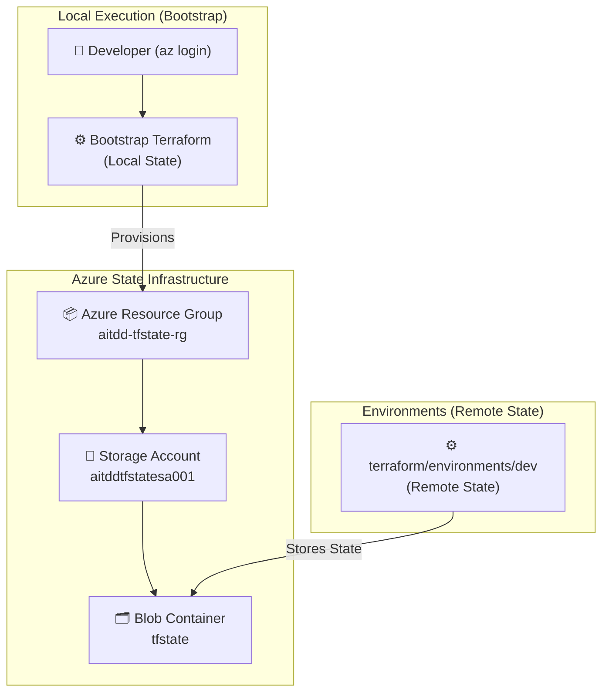
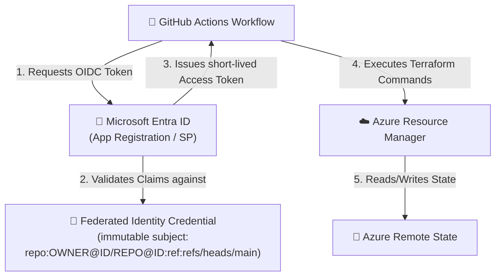
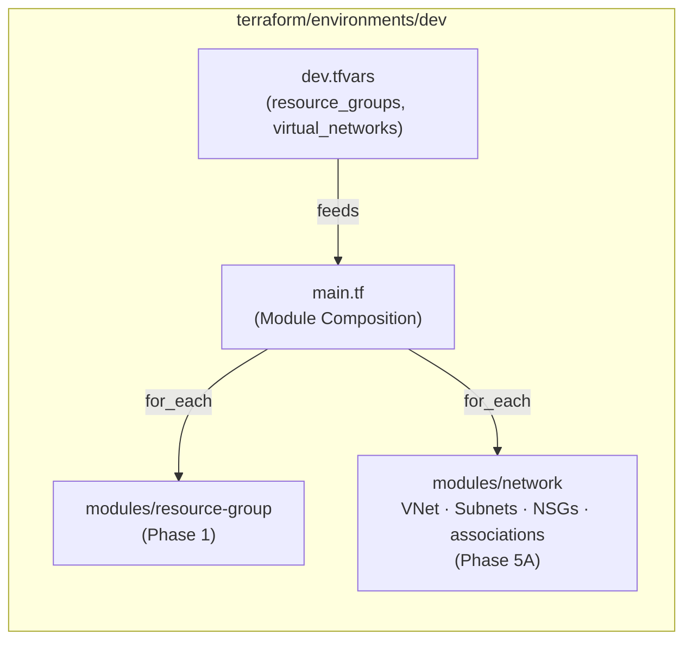

# Architecture — AI-Powered Terraform Drift Detection & Remediation Platform

## 1. Project Purpose

This platform detects, analyzes, and remediates **infrastructure drift** — the gap between what Terraform expects and what actually exists in Azure. The final product will combine Terraform, Python, LangGraph/LLM analysis, GitHub automation, and a professional dashboard.

**Current Status (updated 2026-10-20):** this repository is **Level 1**, released as the baseline tag `level1-v1.0.0` (commit `daa95f8`) and the closeout release `level1-v1.0.1` (commit `6bf410b`). Phases 1–10 and 12 are complete, and so are the lettered phases 5A, 9A and 9B (`PROJECT_PLAN.md`'s "Phases Completed: 11 of 14" counts only the numbered phases); Phase 12's deferred scope was transferred to the Level 2 backlog. Phase 13's dashboard is built, merged and tested: Tasks 13.1–13.4 are complete, and Task 13.5 keeps one open validation item (a recorded check against real GitHub with the owner's token). Phase 11 (human-approved remediation) is on hold since 2026-10-13: its Task 11.1 safeguards specification ([`remediation-safeguards.md`](remediation-safeguards.md), revision 9) is paused under review, nothing is built, and no write access is granted (see "Future / conditional only" below). Phase 14 has not started. A separate Level 2 application is developed in another repository (see [Section 8](#8-level-1-and-the-separate-level-2-repository)). [`PROJECT_PLAN.md`](../PROJECT_PLAN.md) is the single source of truth for status; this document covers the infrastructure, security, CI-access and application design.

*(Status history: on 2026-10-04 this section recorded Phases 1–9 complete and Phase 9A next; on 2026-10-11, Phases 1–10 complete.)*

---

## 2. Phases Scope & Status

| Phase | Description | Scope | Status |
|---|---|---|---|
| **1** | **Azure + Terraform Infrastructure** | Minimal Resource Group baseline in `Central India` | ✅ Complete |
| **2** | **Remote State & Secure Auth** | Dedicated Storage Backend (`Central India`), Bootstrap module, Remote State, GitHub OIDC (plan-only CI) | ✅ Complete |
| **3** | **Deterministic Drift Detection** | Plan evidence, integrity gate, classification, report schema, real Azure drift validation | ✅ Complete |
| **4** | **Python Drift Engine** | `src/drift_engine`: parser, models, comparator, severity, `drift-engine analyze` | ✅ Complete |
| **5** | **Automated Drift Detection Workflow** | `drift-detection.yml`: daily + manual, OIDC, report artifact, `drift_detected` output | ✅ Complete |
| **5A** | **Dev Infrastructure Expansion** | VNet, Subnet, NSG and Subnet–NSG association in `dev` | ✅ Complete |
| **6** | **LangGraph AI Analysis** | `src/ai_engine` library; LLM opt-in; CLI/CI integration added in Phase 9A | ✅ Complete |
| **7** | **Azure Activity Log Investigation** | Activity Log collector and deterministic attribution (the collector runs in CI through the Phase 9B investigation) | ✅ Complete |
| **8** | **GitHub Issue / PR Automation** | Drift issues create/update/close (8.1, 8.3); remediation PRs (8.2) superseded by Phase 11 | ✅ Complete |
| **9** | **DevSecOps Integration** | `security-scan.yml`: TFLint (9.1), Trivy config (9.2), TruffleHog secret scan (9.3); Super-Linter (9.4) deferred to Phase 12 | ✅ Complete |
| **9A** | **AI Analysis Integration** | `ai-analysis` CLI and the no-LLM `ai-analysis.yml` workflow (no Azure access) | ✅ Complete |
| **9B** | **Drift Investigation (WHO / WHEN / WHAT)** | Read-only Activity Log investigation in `drift-detection.yml`; public projections of the drift report and the investigation | ✅ Complete |
| **10** | **FinOps / Cost Analysis** | Infracost plan estimate (10.1), cost delta (10.2), AI cost impact (10.3); read-only unmanaged-resource inventory with an Azure Retail Prices API list-price estimate (10.4), separate from drift and from Infracost | ✅ Complete |
| 11 | Human-Approved Remediation | Task 11.1 safeguards specification only ([`remediation-safeguards.md`](remediation-safeguards.md)); no workflow, environment or write permission | 🔴 On hold (since 2026-10-13); → Level 2 backlog |
| **12** | **Testing & Security Hardening** | Test tiers and `tests.yml` (12.1), plan/log exposure hardening (12.1A), 135-case scenario matrix (12.2), least-privilege and secret audit (12.3) | ✅ Complete; deferred scope (e.g. Super-Linter 9.4) → Level 2 backlog |
| **13** | **Professional Dashboard** | `src/dashboard_api` + `dashboard/` over the real CI artifacts; caller attribution; on-demand GitHub fetch (see [Section 7](#7-level-1-application-architecture)) | 🟡 13.1–13.4 complete; 13.5 validation against real GitHub open |
| 14 | Final Documentation, Demo & Portfolio | See `PROJECT_PLAN.md` | ⬜ Not started; → Level 2 backlog |

---

## 3. Remote Terraform State Architecture (Phase 2)

### The Backend Bootstrap Problem

Terraform remote state backends create a chicken-and-egg problem:
* Remote backend configuration requires an Azure Storage Account and Blob Container to already exist.
* If Terraform manages its own backend storage in the same state, initializing state requires resources that haven't been created yet.

### The Bootstrap Solution

To avoid circular dependencies, the project uses a **dedicated bootstrap module** located at [`terraform/bootstrap`](../terraform/bootstrap):



### Remote State Security Controls

| Security Control | Implementation |
|---|---|
| Dedicated Isolation | State storage lives in its own resource group (`aitdd-tfstate-rg` / `aitddtfstatesa001`), separate from the application resources. No application storage account is deployed. |
| Encryption | Encrypted at rest using Azure-managed keys with TLS 1.2 minimum in transit. |
| Access Control | Container access is private (`container_access_type = "private"`). No public blob access. |
| State Versioning | Storage Blob Versioning enabled for recovery from state corruptions. |
| Soft Delete | Container and Blob 7-day soft-delete retention policies active. |
| No Committed Secrets | Local state, plan artifacts, and credentials are in `.gitignore` (`*.tfstate`, `*.tfstate.*`, `.terraform/`, `tfplan`, `*.tfplan`, `plan.json`). Only `.terraform.lock.hcl` and the secret-free `dev.tfvars` are committed. |
| Dev State Blob | The `dev` environment's state is the blob `dev.tfstate` inside the `tfstate` container. |
| Bootstrap State | `terraform/bootstrap` intentionally keeps **local** state (it provisions the backend it would otherwise store state in). That state is never committed, so CI validates bootstrap offline only (`init -backend=false` + `validate`) and never plans it. |
| Destroy Protection | `lifecycle { prevent_destroy = true }` on the state storage account and container (Task 9.1). Destroying them on purpose requires a reviewed change that removes it first. |
| Network Access | The state account is reached over its public endpoint (no network rules), authenticated with Entra ID, from GitHub-hosted runners with dynamic IPs. Trivy reports this as AZU-0012 (CRITICAL). It is a documented, script-enforced risk acceptance until **2027-03-31** (`security/trivy-risk-acceptance.json`, Task 9.2). Restricting network access is an architecture change outside Phase 9. |

---

## 4. Azure & CI/CD Authentication (Phase 2)

### Local Development Authentication

Local developers authenticate using the Azure CLI:
```bash
az login
az account set --subscription "<subscription-id>"
```
Terraform automatically inherits these credentials without needing hardcoded secrets or service principal keys.

### GitHub Actions OIDC Authentication

For CI/CD automation, the project relies on **GitHub Workload Identity / OpenID Connect (OIDC)** federated credentials instead of long-lived service principal client secrets.



### Azure RBAC Permissions (GitHub OIDC Identity)

The GitHub Actions identity is the Entra ID App Registration / service principal
**`aitdd-github-oidc`**. The following are its **actual, verified** assignments — exactly
two, and nothing else:

| Identity Role | Scope | Purpose |
|---|---|---|
| **Reader** | Subscription | Read-only resource metadata so `terraform plan` can refresh state against live Azure. Grants `*/read` only. Also sufficient for the Task 10.4 unmanaged inventory (`Microsoft.Resources/subscriptions/resourceGroups/resources/read` and the per-resource reads); no new role was needed. |
| **Storage Blob Data Contributor** | `tfstate` **container** (`aitddtfstatesa001`) | Read, write, and lock the Terraform state blobs in that one container. |

Deliberately **not** assigned to this identity:

| Not Assigned | Why |
|---|---|
| `Storage Blob Data Contributor` at subscription or storage-account scope | Container scope is narrower; a broader grant would expose every blob container in the subscription. |
| `Contributor` on any scope | CI is **plan-only**. Write access is not required and is withheld by design. |
| `Owner`, `User Access Administrator` | Never required by this workload. |
| `Key Vault Secrets Officer` | No Key Vault is deployed. |

The identity has **no group or directory-role memberships**, so there are no inherited
permission paths, and it requests **no** Microsoft Graph or API permissions.

### CI Security Model — Plan-Only

GitHub Actions is currently **plan-only** and has **no autonomous `terraform apply`
capability**. This is enforced by RBAC, not merely by workflow convention: the identity
holds no write actions. Verified against the Azure role definitions —
`resourceGroups/write`, `resourceGroups/delete`, `storageAccounts/write`,
`storageAccounts/listkeys/action`, and `deployments/write` are all **denied**.

Because `listkeys` is denied, Terraform cannot retrieve a storage account access key.
State access therefore goes through Microsoft Entra ID on the storage data plane
(`ARM_USE_AZUREAD=true`), with no account key and no client secret anywhere in the
pipeline.

### CI Workflows and Their Access

| Workflow | Trigger | Azure access | GitHub permissions |
|---|---|---|---|
| `terraform-auth-test.yml` (Phase 2; Task 12.1A) | push / PR to `main` (or `master`), manual | Job `offline-validate` (every event): **none**, `terraform fmt` and `init -backend=false` + `validate`. Job `validate-and-plan` (not on pull requests): OIDC, read-only `plan`; only the exit code and change counts are printed (Task 12.1A) | `offline-validate`: `contents: read`; `validate-and-plan`: `id-token: write`, `contents: read` |
| `tests.yml` (Phase 12) | push to `main`, every PR, manual | **None** (no login, no OIDC, no secrets) | `contents: read` only |
| `drift-detection.yml` (Phases 5, 8, 9B, 10) | daily 02:00 UTC, manual; `main` only | OIDC in the plan job only (Terraform plan, read-only Activity Log queries for the drift investigation and read-only ARM resource listing of the Terraform-managed resource groups for the unmanaged inventory, Task 10.4); never `apply`, import or any write | `plan-and-analyze`: `id-token: write`, `contents: read`, `actions: read` (anchor fetch); `issues`: `contents: read`, `issues: write`; `cost`, `investigation` and `unmanaged`: `contents: read`; none of these four has Azure access (`unmanaged` calls only the public Azure Retail Prices API, without credentials) |
| `ai-analysis.yml` (Phases 9A, 9B, 10) | after each completed drift-detection run on `main` (`workflow_run`) | **None** | `contents: read`, `actions: read`; only `github.token`, to download the source run's public drift report, investigation, Infracost report (Task 10.3) and unmanaged-resources report (Task 10.4) |
| `security-scan.yml` (Phase 9) | push / PR to `main`, manual | **None** (no login, no OIDC; TruffleHog uses `--no-verification`, so no candidate secret is sent anywhere) | `contents: read` only; no token |

Only the `main` branch has a federated credential. Pull requests therefore run only the offline
validation job of `terraform-auth-test.yml`; the Azure login and `plan` job runs on trusted events
(push to `main`, manual dispatch). The dashboard (Section 7) is not a workflow: it runs on the
owner's machine and has no Azure write access either.

Every action in every workflow is pinned by full commit SHA, `id-token: write` is granted only to the
job that logs in to Azure (never at workflow level), and no checkout keeps its credentials
(`tests/test_workflow_pins.py`). `main` accepts changes only through a pull request whose six checks
(both `tests.yml` jobs, the three `security-scan.yml` jobs and `Terraform Offline Validation`) pass.

> **Future / conditional only — not current access.** Should a later phase introduce
> automated remediation, any write capability (for example a narrowly scoped
> `Contributor` on `aitdd-dev-main-rg`) would be a **future** change requiring explicit
> human approval, and is **not** granted today. The project principle *No autonomous
> apply* stands: remediation requires human approval.

---

## 5. Modular Infrastructure Architecture (Phases 1 and 5A)



### Data-Driven Design & Incremental Expansion

1. **Minimal Foundation**: Phase 1 activated only the Azure Resource Group (`aitdd-dev-main-rg`) in `Central India`, the smallest practical baseline for establishing remote state and testing deterministic drift detection.
2. **Network Expansion (Phase 5A)**: the `network` module adds one VNet with a subnet, an NSG (rule set declared empty, so out-of-band rules show as drift) and the subnet–NSG association, all inside the existing resource group. Only `modules/resource-group` and `modules/network` exist; there are no storage or Key Vault modules.
3. **Data-Driven Scalability**: additional resources are added to the corresponding map in `dev.tfvars` without redesigning core architectures.
4. **Static Checks (Phase 9)**: every module declares its Terraform and AzureRM constraints (`versions.tf`, matching the roots), and `terraform/` is checked by TFLint and Trivy config in `security-scan.yml`.

---

## 6. Resource Naming Convention

```
<project_name>-<environment>-<resource_name>-<resource_type_suffix>
```

| Example | Breakdown |
|---|---|
| `aitdd-tfstate-rg` | Resource group containing Terraform state storage |
| `aitddtfstatesa001` | Dedicated storage account for state (3-24 lowercase alphanumeric) |
| `aitdd-dev-main-rg` | Application dev resource group |
| `aitdd-dev-main-vnet` | Main dev virtual network (10.10.0.0/16) |
| `aitdd-dev-main-app-snet` | Application subnet (10.10.1.0/24) |
| `aitdd-dev-main-app-nsg` | Application Network Security Group |

---

## 7. Level 1 Application Architecture

How the parts fit together in Level 1 (tag `level1-v1.0.0`). Details: [`drift-detection-spec.md`](drift-detection-spec.md) for the detection rules, [`dashboard.md`](dashboard.md) for the dashboard, `README.md` for commands.

```text
Azure (dev)  <-- read-only OIDC --  GitHub Actions: drift-detection.yml (daily + manual)
                                      plan evidence -> drift-engine analyze -> public drift report
                                      Activity Log investigation (who / when / what)
                                      Infracost estimate; unmanaged-resource inventory + list prices
                                      drift issues (create / update / close)
                                           |
                                           v  run artifacts
                                    ai-analysis.yml (no Azure access): AI report v4, no LLM in CI
                                           |
           owner's machine                 v
           scripts/fetch_dashboard_data.py (read-only GitHub token, on demand)
                 -> .artifacts/dashboard (ignored, 0700)
                 -> dashboard-api (loopback only, local sign-in token, roles)
                 -> browser UI (dashboard/)
```

| Layer | Implemented in | Verified by |
|---|---|---|
| Terraform evidence and integrity gate | `scripts/generate_plan_json.sh`, `drift-detection.yml` | Real Azure drift tests (Tasks 3.6–3.7, 9B.6); CI runs |
| Deterministic drift engine | `src/drift_engine/` (`drift-engine analyze`, public projection) | Unit and scenario tests (Phase 12; 135-case matrix) |
| Investigation, attribution | `src/drift_engine/activity_logs.py`, `attribution.py`, `investigation.py`, `who.py` | Real Azure cycle 2 (Task 9B.6) |
| Cost and unmanaged resources | `scripts/infracost_analysis.sh`, `src/drift_engine/cost.py`, `inventory.py`, `unmanaged_cost.py` | Real Azure/CI run #44 (Tasks 10.3, 10.4) |
| AI analysis | `src/ai_engine/`, `ai-analysis.yml` (no LLM in CI) | Real CI run (Task 9A.1), run #27 |
| Drift issues | `scripts/github_automation.py` | Tasks 8.1, 8.3 |
| Dashboard | `src/dashboard_api/` (FastAPI, loopback), `dashboard/` (browser UI), `scripts/run_dashboard.sh`, `scripts/fetch_dashboard_data.py` | Automated tests (API, UI, launcher, fetch); owner's own testing on 2026-10-18; open items listed in `PROJECT_PLAN.md` (Tasks 13.3, 13.5) |

**What Level 1 does not do:** no `terraform apply`, import or any Azure write from CI or the dashboard; no remediation (Phase 11 on hold); the AI engine never decides whether drift exists; the dashboard never runs Terraform or a scan and reads only artifacts already produced by CI.

---

## 8. Level 1 and the Separate Level 2 Repository

- **Level 1** is this repository, frozen as the release tag `level1-v1.0.0` (annotated tag `fe07743` → commit `daa95f8`, the merge of PR #14 after PR #13). It stays the stable, reproducible baseline and is **maintenance-only** since 2026-10-18: only bug fixes, security fixes and documentation corrections, each through a pull request with CI; no new features or phases. The tag `level1-v1.0.0` is never moved; a fix release would get its own new tag. New development happens in Level 2.
- **Level 2** is a separate, more user-friendly, local-first application in the private repository `HarshAgarwal1102/ai-terraform-drift-detector-v2` (package `aitdd-drift`, command `aitdd`). It has its own plan, dependencies, tests, CI/CD, access control and releases.
- **What Level 2 took from Level 1:** only the nine drift-engine modules (`parser`, `classifier`, `comparator`, `severity`, `models`, `report_public`, `investigation_public`, `formatters`, `logs`) and the public report schema, copied once from the tag with two recorded renames, plus 16 test fixtures. It records their provenance and tests that it produces the same public reports and exit codes as Level 1.
- **What Level 2 never does:** install, import or depend on Level 1, or change this repository. Level 2's roadmap is kept in the Level 2 repository, not in this one.
